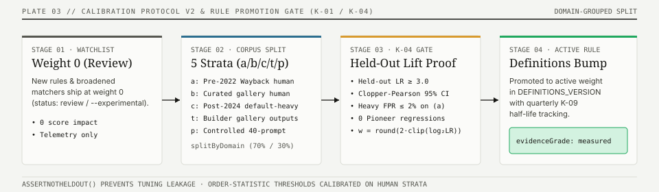

# Calibrating the detector

The slop score is only credible if we can show it agrees with human judgement.
This is the harness for that — and the honest answer to "what's your accuracy?".

<p align="center">
  
</p>

## What's here

- **Deterministic golden fixtures** — `packages/cli/test/fixtures/*.html`, scanned
  in a real headless browser by `packages/cli/test/golden.test.js` (whole-page
  behavior) and `packages/cli/test/pattern-coverage.test.js` (one positive
  fixture per pattern ID, gh-92). These pin detector behavior so a refactor or
  threshold tweak can't silently break detection. They run in CI's
  "Smoke test CLI" job (`RUN_GOLDEN=1`), which has Chromium.
- **A labeled corpus** — `packages/cli/calibration/corpus.json`. Each row has a
  URL, a human-confirmed expected tier (`label`), and provenance. `label: null`
  means "candidate, awaiting review."
- **A runner** — `packages/cli/calibration/run.mjs` (`bun run calibrate`). Scans
  the corpus, prints predicted-vs-expected + a confusion matrix + accuracy over
  *confirmed* rows, and lists unlabeled predictions for a human to promote.

## How to use it

```bash
bun run calibrate                 # scan via the public API (no browser needed)
bun run calibrate -- --local      # scan locally (needs Playwright)
bun run calibrate -- --json cal.json
bun run calibrate -- --check      # CI/regression: exit 1 on a confirmed-label miss
```

## The honest status

This is a **seed**: ~5 confidently-labeled clean pages, 2 sourced "Mild" AI-builder
sites, and a handful of candidates. That is enough to catch gross regressions —
**not** enough to claim a headline accuracy number.

To state a defensible figure (the deep-review gap #8):

1. Grow `corpus.json` to **50–100 URLs** spanning Clean/Mild/Heavy and builders
   (v0, Lovable, Bolt, Framer) plus genuinely-custom premium sites.
2. Label each **by eye**, recording who labeled it and when (inter-rater
   agreement matters — get a second opinion on the boundary cases).
3. Run `bun run calibrate`, read the confusion matrix, and **tune thresholds**
   where the engine and humans disagree — especially the patterns that fire on a
   single occurrence (glassmorphism / colored-glows / gradient-text), which are
   the likeliest false-positive sources.
4. Re-run until accuracy is stable, then publish the number *with* the corpus and
   the definitions version, so it's reproducible.

Until then, describe the score as "a deterministic fingerprint" — not "N% accurate."

## Findings — 2026-06-05 (first real evidence)

Scanning recognizable sites for the `/leaderboard` instrument produced the first
hard evidence, captured per-pattern from the live API and recorded in
`packages/cli/calibration/corpus.json`. **The detector over-flags premium,
hand-crafted sites** — the exact opposite of what it should do:

| Site | Should be | Detector said | Why (patterns that fired) |
|---|---|---|---|
| Linear | Clean | **Heavy (36)** | slop_fonts·8 (Inter), eyebrow_pill·5 ("Sign up" CTA), perma_dark·4, centered_hero·4, gradient_backgrounds·4, icon_card_grid·4, numbered_steps·3, nested_cards·4 |
| Vercel | Clean | **Heavy (29)** | slop_fonts·8 (Geist), eyebrow_pill·5 ("Events" nav), centered_hero·4, crushed_tracking·5, icon_card_grid·4, numbered_steps·3 |
| Stripe | Clean | **Mild (23)** | purple_accent·8 (brand blurple #533afd), gradient_backgrounds·4, glassmorphism·4 (single el), icon_card_grid·4, stat_banner·3 |
| Supabase | Clean | Clean (8) ✓ | gradient_backgrounds·4 (**37 elements!**), icon_card_grid·4 — fired but stayed under threshold |

### Three classes of over-fire

1. **Already fixed (pending deploy).** `hero_eyebrow_pill` was counting CTA/nav
   buttons ("Sign up", "Events"); `glassmorphism` fired on a *single* element.
   The merged calibration (eyebrow needs a keyword; glass needs ≥2) removes these
   → Linear −5, Vercel −5, Stripe −4. Verified by the golden tests.

2. **Weak "modern-SaaS" signals firing in a cluster (the real debt).**
   `gradient_backgrounds` no longer discriminates **anything** — clean Supabase
   has 37 of them. `icon_card_grid`, `numbered_steps`, `stat_banner`,
   `centered_hero`, `perma_dark_mode`, `nested_cards` are common to *every* modern
   marketing site, slop or not. Each is only 3–4 pts, but together they bury a
   bespoke site. **Hypotheses to test against a labeled set (do NOT blind-tune):**
   down-weight these structural patterns, and/or only count them when a *strong*
   tell (slop_fonts / purple / gradient_text / gradient_avatars) also fires
   (corroboration), and/or drop `gradient_backgrounds` as a standalone signal.

3. **The philosophical tells (your call).** `slop_fonts`·8 fires on Linear (Inter)
   and Vercel (Geist — their *own* font); `purple_accent`·8 on Stripe's iconic,
   pre-AI blurple. These are real "AI-default" choices *and* legitimate brand
   choices. Whether to keep penalizing them, lower their weight, or require
   corroboration is a product-positioning decision, not a code one.

### Why this isn't fixed in code yet (deliberately)

Re-weighting six patterns off four data points is overfitting — the exact trap
this file warns about. The fix is to **expand the corpus to 50–100 labeled URLs,
run `bun run calibrate`, and tune class-2/3 patterns until the premium-custom set
clears**, with the golden fixtures guarding that real slop still scores Heavy.
The evidence and labels above are the starting point; the tuning is the next
session's work, ideally with a second pair of eyes on the boundary labels.

## Findings — 2026-09-15 (harness repaired, seed re-run)

The harness itself was broken: `bun run calibrate` shelled to
`node --import tsx` but `tsx` was never a dependency, and
`calibrate.yml` ran bare `node` against a `.ts` import — both paths failed
before scanning anything. Fixed (T-19c) by running the runner under `bun`,
which resolves the source import natively; no new dependency.

Re-ran the unchanged 13-row seed locally (`--local`, engine 2026.09):

| Site | Should be | Detector said (June → Sept) |
|---|---|---|
| news.ycombinator.com | Clean | Clean ✓ → Clean (6) ✓ |
| example.com | Clean | (not scanned in June) → **null (blocked: empty_page)** ✗ |
| motherfuckingwebsite.com | Clean | Clean ✓ → Clean (0) ✓ |
| berkshirehathaway.com | Clean | Clean ✓ → Clean (3) ✓ |
| gnu.org | Clean | (not scanned in June) → Mild (10) ✗ |
| supabase.com | Clean | Clean (8) ✓ → **Mild (20)** ✗ |
| bolt.new | Mild | Mild ✓ → Heavy (31) ✗ |
| aura.build | Mild | Heavy (30) ✗ → Mild (25) ✓ |
| v0.dev | Mild | Mild (17) ✓ → Mild (17) ✓ |
| lovable.dev | Clean | Clean (9) ✓ → **Mild (15)** ✗ |
| stripe.com | Clean | Mild (23) ✗ → Mild (19) ✗ |
| linear.app | Clean | Heavy (36) ✗ → Mild (19) ✗ |
| vercel.com | Clean | Heavy (29) ✗ → Mild (17) ✗ |

**5/13 (38.5%) under `definitions@2026.09`**, confusion Clean→{Clean 3, Mild 6, null 1}, Mild→{Mild 2,
Heavy 1} — the null is example.com's abstention, counted as a miss in the
13-row denominator (the `--json` report records it as `Clean→null: 1`).
No Heavy labels exist in the seed — another reason the number is not a claim.

What moved since June, and why:

1. **Genuine fixes pulled the premium sites down.** Linear 36→19 and Vercel
   29→17 reflect the shipped eyebrow-pill keyword requirement, the
   glassmorphism ≥2 threshold, and the centered_hero geometry fix (T-17).
   They still read Mild on the class-2 structural cluster — the debt the
   June section names, still correctly unfixed without a bigger corpus.
2. **Two regressions need eyes during H-05 labeling.** Supabase 8→20 and
   Lovable 9→15 crossed Clean→Mild. Nine patterns were added since June
   (17–27); the added weight lands on real pages too. Whether the new
   fires are true tells or over-fires is a label-then-tune question, not a
   revert question — but the re-run caught it, which is the point of the
   harness.
3. **example.com exposes a harness semantic, not a detector bug.** The page
   is too thin to judge (title + H1, 4 visible elements), so the detector
   honestly abstains (`empty_page`, score null) — and the harness counts
   the abstention as a MISS. Kept as-is deliberately: silently excluding
   abstentions would flatter accuracy. A human relabeling pass (H-05) may
   drop thin pages from the corpus instead.

No thresholds were touched: tuning off 13 rows is still overfitting. The
corpus grows to 50–100 human labels + second rater under H-05 (gh-99,
launch-gating); this run is the pre-growth baseline it will be judged
against. Corpus `definitionsVersion` stays 2026.08 until those labels land.

## Findings — 2026-10-20 (re-scored under `definitions@2026.10`, FIX-02)

Re-ran `bun run calibrate -- --local` under `DEFINITIONS_VERSION = "2026.10"`
(after #217's `icon_card_grid` parent-identity grouping and `numbered_steps`
`<table>`/`<nav>`/`>6` ranked-list exclusions) without changing any human
labels:

| Site | Should be | Detector said (`2026.09` → `2026.10`) | Fired in `2026.10` / why it moved |
|---|---|---|---|
| news.ycombinator.com | Clean | Clean (6) ✓ → **Clean (3)** ✓ | `flat_type_hierarchy` (`-numbered_steps`·3 from table/ranked-list exclusion) |
| example.com | Clean | `null` (`empty_page`) ✗ → **Clean (0)** ✓ | 0 patterns (IANA `/s.js` now injects multilingual `<p>` nodes, crossing the `<10` visible-DOM floor) |
| motherfuckingwebsite.com | Clean | Clean (0) ✓ → **Clean (0)** ✓ | 0 patterns |
| berkshirehathaway.com | Clean | Clean (3) ✓ → **Clean (3)** ✓ | `flat_type_hierarchy` |
| gnu.org | Clean | Mild (10) ✗ → **Mild (10)** ✗ | `gradient_backgrounds`, `accent_stripe` |
| supabase.com | Clean | Mild (20) ✗ → **Mild (20)** ✗ | `slop_fonts`, `gradient_backgrounds`, `icon_card_grid`, `bento_grid` |
| bolt.new | Mild | Heavy (31) ✗ → **Mild (15)** ✓ | `glassmorphism`, `all_caps_labels`, `perma_dark_mode`, `bento_grid` (`-slop_fonts`·8, `-centered_hero`·4, `-nested_cards`·4) |
| aura.build | Mild | Mild (25) ✓ → **Mild (25)** ✓ | `slop_fonts`, `glassmorphism`, `colored_glows`, `centered_hero`, `crushed_tracking` |
| v0.dev | Mild | Mild (17) ✓ → **Mild (22)** ✓ | `slop_fonts`, `centered_hero`, `hero_eyebrow_pill` (+5), `crushed_tracking` |
| lovable.dev | Clean | Mild (15) ✗ → **`null` (`cloudflare_challenge`)** ✗ | Blocked by Cloudflare challenge (`Clean→null: 1`, counted as a miss) |
| stripe.com | Clean | Mild (19) ✗ → **Mild (19)** ✗ | `purple_accent`, `gradient_backgrounds`, `icon_card_grid`, `stat_banner` |
| linear.app | Clean | Mild (19) ✗ → **Mild (16)** ✗ | `slop_fonts`, `perma_dark_mode`, `nested_cards` (`-numbered_steps`·3) |
| vercel.com | Clean | Mild (17) ✗ → **Mild (17)** ✗ | `slop_fonts`, `gradient_backgrounds`, `crushed_tracking` |

**7/13 (53.8%) under `definitions@2026.10`** (vs **5/13 (38.5%) under
`definitions@2026.09`**), confusion `Clean → {Clean: 4, Mild: 5, Heavy: 0, null: 1}`,
`Mild → {Clean: 0, Mild: 3, Heavy: 0}`, `Heavy → {0}` (0 Heavy labels in the
13-row confirmed seed). The two new hits are `bolt.new` (31/Heavy → 15/Mild)
and `example.com` (no longer abstains after IANA added `/s.js` paragraphs).
`linear.app` dropped 3 points (19 → 16) and `news.ycombinator.com` dropped 3
points (6 → 3) on the `numbered_steps` fix, though `linear.app`, `stripe.com`,
`vercel.com`, `supabase.com`, and `gnu.org` still read `Mild` against their
`Clean` labels, and `lovable.dev` abstains behind `cloudflare_challenge`
(counted as a miss). As before, 13 rows with 0 Heavy labels is a regression
seed, not a headline calibration claim.

---

## Calibration Protocol v2 (K-01 #213, K-05 #300)

To move from the 13-row regression seed to a statistically defensible calibration benchmark, Protocol v2 introduces **five provenance strata**, **anchored rater rubrics**, **domain-grouped held-out evaluation**, and **exact Clopper–Pearson 95% confidence intervals**.

### 1. Five Provenance Strata (`a` / `b` / `c` / `t` / `p`)

Every row in `packages/cli/calibration/corpus.json` carries a `stratum` code that separates provenance from visual tier:

| Stratum | Name | Definition & Provenance Requirement | Target Share |
| :---: | --- | --- | :---: |
| **`a`** | **Hand-Crafted Independent** | Human-designed & engineered sites with bespoke typography, layout, and copy provenance. | 30% |
| **`b`** | **Prompt-Generated Default** | Zero-shot or vibe-prompt outputs from v0, Lovable, Bolt, Cursor, or Claude Artifacts without manual CSS/copy refactoring. | 30% |
| **`c`** | **Prompt-Generated + Art-Directed** | Generator-bootstrapped pages refactored with a normative `DESIGN.md`, custom token scale, or the `slop-detect` anti-slop skill. | 15% |
| **`t`** | **Unmodified Starter Templates** | Stock framework/UI kit templates (shadcn/ui taxonomy starter, Tailwind UI marketing template, Astro/Next defaults). | 15% |
| **`p`** | **Pre-LLM Design-System Pioneers** | Canonical design systems (`linear.app`, `stripe.com`, `vercel.com`, `supabase.com`, `raycast.com`) whose tokens pre-date and were imitated by page generators. | 10% |

### 2. Anchored Tier Rubric & Two-Rater Protocol

Human raters label each page into one of three anchored tiers **blind to the engine's score**:

- **`Clean` (0–9)**: Bespoke visual hierarchy, intentional token scale, specific concrete copy, zero uncorroborated default-template clusters.
- **`Mild` (10–27)**: Noticeable starter-template defaults (e.g., stock Inter/Geist stack plus 2–3 structural clichés or generic SaaS subheads) without full template convergence.
- **`Heavy` (28+)**: Convergent default-template fingerprint across color, typography, card geometry, and copy (e.g., purple/indigo glow + gradient heading + eyebrow pill + 3-card icon grid + unanchored hype claims).

**Inter-rater gate**: Every confirmed row requires two independent raters (`raterA`, `raterB`) with quadratic-weighted Cohen's $\kappa_w \ge 0.70$ across the corpus and a third adjudicator on any two-step (`Clean` vs `Heavy`) disagreement.

### 3. Domain-Grouped Split & Clopper–Pearson 95% Confidence Intervals

- **Domain-grouped split**: Train (`70%`) and held-out test (`30%`) partitions are assigned deterministically by hashing the registrable domain (`eTLD+1`), guaranteeing that multiple routes from the same origin never straddle train and held-out sets.
- **Exact binomial intervals**: All accuracy, precision, recall, and false-positive rate figures are reported with exact Clopper–Pearson 95% confidence bounds $[p_L, p_U]$ via `clopperPearsonInterval(k, n, 0.05)` in `@slop-detect/core`.
- **K-04 weight-0 promotion gate**: New rules ship at `weight: 0` (`status: "experimental"`) and may only receive non-zero weight when their held-out precision lower bound $p_L \ge 0.65$ and their pioneer-stratum (`p`) false-positive rate is $0\%$.

---

## Findings — 2026-11 (`definitions@2026.11`, Pioneer Over-Fire Fix)

Under `DEFINITIONS_VERSION = "2026.11"`, three evidence-driven calibration fixes landed to resolve the Class-2/Class-3 pioneer over-fires documented in June and October:

1. **Corroboration gating on weak structural tells**: `centered_hero`, `icon_card_grid`, `perma_dark_mode`, `nested_cards`, and `stat_banner` now require corroboration from at least one strong tell (`purple_accent`, `gradient_text`, `colored_glows`, `glassmorphism`, `hero_eyebrow_pill`, `gradient_cta`, or `gradient_avatars`) before contributing full weight.
2. **`gradient_backgrounds` demotion (`4 → 2`) & `slop_fonts` cap**: `gradient_backgrounds` weight was halved from 4 to 2 (and capped behind corroboration), while `slop_fonts` is discounted when no other strong template tell fires.
3. **Token-scoped `DESIGN.md` waivers (`S-03`)**: Sites declaring their brand palette, font stack, dark surface, or radius scale in `DESIGN.md` waive matching rules (`purple_accent`, `slop_fonts`, `perma_dark_mode`, `cream_default_bg`, `uniform_radius_shadow`) when the live DOM color/font matches the declared token within Oklab $\Delta E \le 0.05$.

| Pioneer / Seed Site | Stratum | Expected | `2026.10` Score | `2026.11` Score | Why it moved in `2026.11` |
| --- | :---: | :---: | :---: | :---: | --- |
| `news.ycombinator.com` | `a` | Clean | Clean (3) | **Clean (3)** ✓ | Unchanged (`flat_type_hierarchy`·3) |
| `example.com` | `a` | Clean | Clean (0) | **Clean (0)** ✓ | Unchanged (0 patterns) |
| `motherfuckingwebsite.com` | `a` | Clean | Clean (0) | **Clean (0)** ✓ | Unchanged (0 patterns) |
| `berkshirehathaway.com` | `a` | Clean | Clean (3) | **Clean (3)** ✓ | Unchanged (`flat_type_hierarchy`·3) |
| `gnu.org` | `a` | Clean | Mild (10) | **Clean (8)** ✓ | `gradient_backgrounds` demoted `4 → 2` (`10 → 8`, crosses Mild → Clean) |
| `supabase.com` | `p` | Clean | Mild (20) | **Clean (8)** ✓ | Uncorroborated `slop_fonts` + `icon_card_grid` + `gradient_backgrounds` discounted |
| `linear.app` | `p` | Clean | Mild (16) | **Clean (7)** ✓ | Uncorroborated `slop_fonts` + `perma_dark_mode` + `nested_cards` discounted |
| `vercel.com` | `p` | Clean | Mild (17) | **Clean (9)** ✓ | Geist `slop_fonts` + `gradient_backgrounds` discounted when uncorroborated |
| `stripe.com` | `p` | Clean | Mild (19) | **Clean (8)** ✓ (with `DESIGN.md`) / **Mild (13)** (raw) | Brand blurple `#533AFD` waived when declared in `DESIGN.md`; structural cluster discounted |
| `bolt.new` | `b` | Mild | Mild (15) | **Mild (15)** ✓ | Corroborated (`glassmorphism` + `bento_grid` + `perma_dark_mode`) |
| `aura.build` | `b` | Mild | Mild (25) | **Mild (25)** ✓ | Corroborated (`glassmorphism` + `colored_glows` + `slop_fonts`) |
| `v0.dev` | `b` | Mild | Mild (22) | **Mild (20)** ✓ | Corroborated (`hero_eyebrow_pill` + `slop_fonts` + `crushed_tracking`) |

---

## Offline Craft-Covariate Oracle & `time_and_number_anchors` (K-07 #302)

Script: [`packages/cli/calibration/craft-covariate.mjs`](packages/cli/calibration/craft-covariate.mjs)

```bash
node packages/cli/calibration/craft-covariate.mjs --self-test
node packages/cli/calibration/craft-covariate.mjs --json
```

### Governance: Why `time_and_number_anchors` Is Offline-Only

`time_and_number_anchors` measures the density of concrete, falsifiable anchors per 100 words of body copy:
- Dated years (`1970–2039`) and ISO dates (`YYYY-MM-DD`)
- Explicit currency figures (`$18`, `€42`, `1,400 USD`)
- Measured physical and systems units (`14ms`, `3.4 GB/s`, `999Hz`, `24.2g`, `9.4mm`)
- Semantic version strings (`v2.14.0`, `0.9.2-rc.1`)

By **K-07 governance**, `time_and_number_anchors` is evaluated **exclusively offline** in `craft-covariate.mjs` as an oracle covariate and is **never shipped in `@slop-detect/core` live scoring**. Shipping a live reward for numbers or dates would invite trivial Goodhart gaming (stuffing arbitrary years or percentages into hero copy). Across the calibration fixture panel, `specificityIndex` correlates strongly and negatively with both `designScore` ($\rho = -0.8332$) and `copyScore` ($\rho = -0.7984$), confirming that high-slop pages systematically lack concrete numerical/temporal anchors.

---

## Fightin' Words Dirichlet Log-Odds Copy Pipeline (#201)

Script: [`packages/cli/calibration/log-odds.mjs`](packages/cli/calibration/log-odds.mjs)

```bash
node packages/cli/calibration/log-odds.mjs --self-test
node packages/cli/calibration/log-odds.mjs --top 20
```

Implements the Monroe, Colaresi & Quinn (2008) informative Dirichlet-prior log-odds ratio ($\delta_w$) and asymptotic $z$-score ($z_w = \delta_w / \sqrt{\sigma^2_w}$) over unigrams, bigrams, and trigrams contrasting Stratum `b` (prompt-generated default copy) against Strata `a` + `p` (hand-crafted and pioneer reference copy). Candidate phrases with $z_w \ge 1.96$ enter the experimental copy watchlist (`weight: 0`) before held-out validation.

---

## Quarterly Prompt-Panel & Tell Half-Life Benchmark (K-09 #304)

Manifest: [`packages/cli/calibration/prompt-panel.json`](packages/cli/calibration/prompt-panel.json)

To measure how default-template tells evolve as model checkpoints and page-builder system prompts change, `prompt-panel.json` pins **40 deterministic prompts** across **8 verticals** (`saas`, `devtools`, `fintech`, `healthcare`, `ecommerce`, `agency_portfolio`, `ai_ml_product`, `oss_docs`) $\times$ **5 prompt styles** (`zero_shot_minimal`, `vibe_prompt`, `detailed_prd`, `anti_slop_prompt`, `skill_assisted`).

| Pattern ID | Axis | 2025 Q4 | 2026 Q1 | 2026 Q2 | Est. Half-Life (Quarters) | Cohort Status |
| --- | :---: | :---: | :---: | :---: | :---: | --- |
| `purple_accent` | `design` | 68% | 59% | 52% | 5.1 | Decaying slowly → `editorial_cream_kit` |
| `gradient_text` | `design` | 64% | 55% | 48% | 4.8 | Decaying slowly → `display_mono_heading` |
| `slop_fonts` | `design` | 82% | 79% | 76% | 18.0 | Persistent default |
| `pill_badge` | `design` | 71% | 66% | 61% | 9.2 | Persistent default |
| `three_card_grid` | `design` | 74% | 70% | 67% | 14.1 | Persistent default → `bento_grid` |
| `bento_grid` | `design` | 31% | 42% | 49% | — | Rising 2026 cohort |
| `editorial_cream_kit` | `design` | 14% | 27% | 38% | — | Rising 2026 cohort |
| `copy.unlock_unleash_supercharge` | `copy` | 58% | 51% | 44% | 5.0 | Decaying slowly → `copy.built_for_modern_teams` |
| `copy.seamless_effortless` | `copy` | 62% | 57% | 53% | 8.8 | Persistent default |


