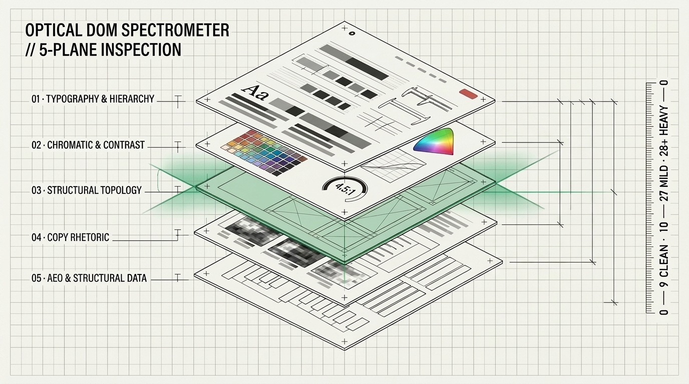
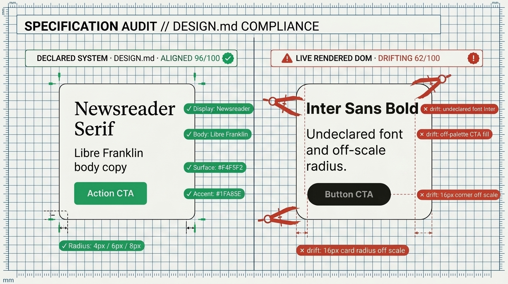
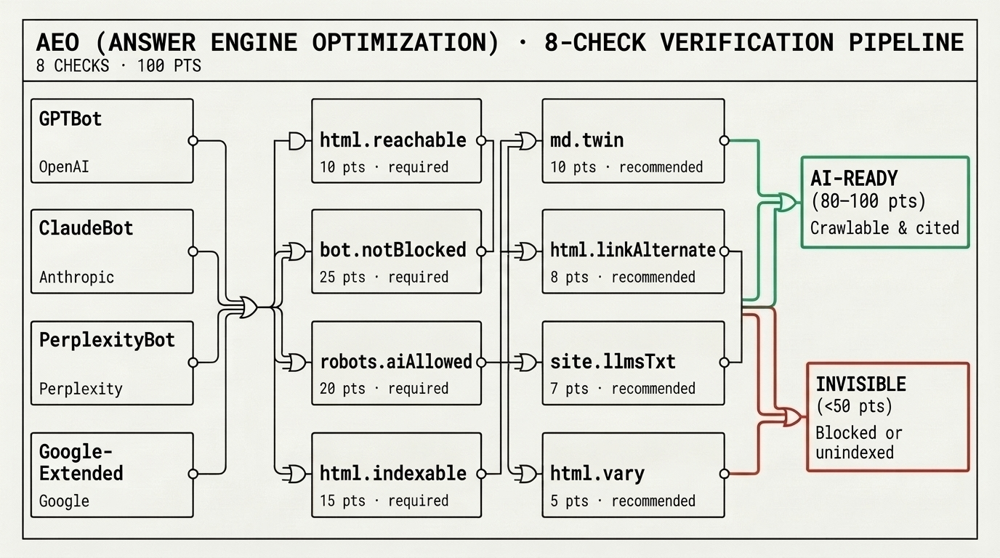
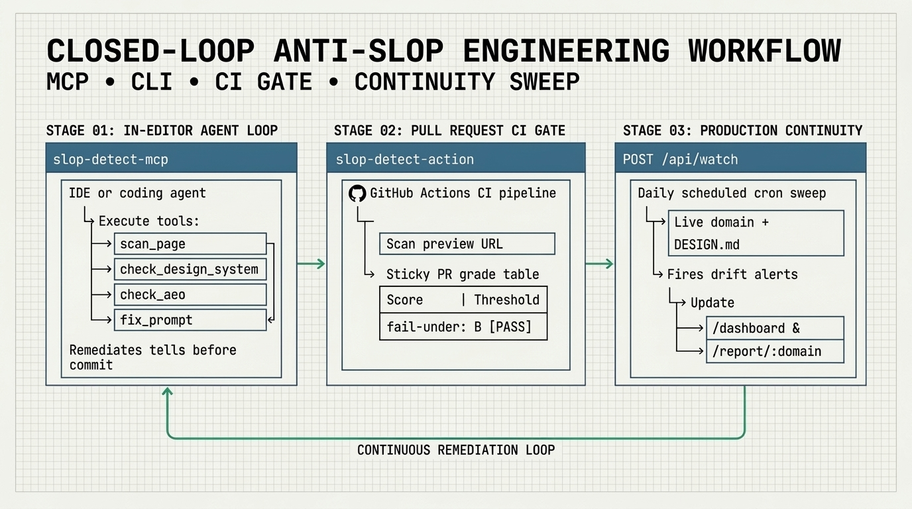
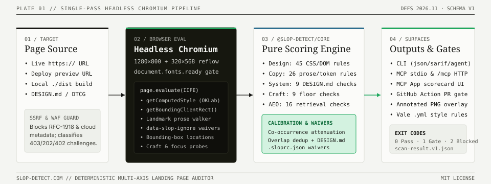

# slop-detect

> **Score any landing page against the versioned design-slop fingerprint, copy axis, `DESIGN.md` system compliance, craft floor, and AEO readiness — then keep it clean.**
> Audit live pages in real headless Chromium, verify rendered tokens against your own `DESIGN.md`, check if AI answer engines can read and cite your site, and generate a copy-paste remediation prompt for your coding agent. Monitor a domain and get alerted when it drifts.

<p>
  <a href="https://github.com/ravidsrk/slop-detect/actions"></a>
  <a href="https://www.npmjs.com/package/slop-detect"></a>
  <a href="https://www.npmjs.com/package/slop-detect-core"></a>
  <a href="https://www.npmjs.com/package/slop-detect-mcp"></a>
  <a href="https://slop-detect.com"></a>
  <a href="LICENSE"></a>
  
</p>

<p>
  <a href="#1-why-this-exists">1. Why This Exists</a> ·
  <a href="#2-quickstart-try-it-now">2. Quickstart</a> ·
  <a href="#3-the-five-axis-scoring-model">3. The 5 Axes</a> ·
  <a href="#4-the-fix-prompt--creative-brief-generator">4. Fix Prompts</a> ·
  <a href="#5-ai-coding-agents-mcp-skills--ide-plugins">5. AI Agents &amp; MCP</a> ·
  <a href="#6-cicd-gates-github-action--build-plugins">6. CI &amp; Deploy Gates</a> ·
  <a href="#7-programmatic-sdk-slop-detect-core--rest-api">7. SDK &amp; API</a> ·
  <a href="#8-share-badges-directory--domain-monitoring">8. Badges &amp; Monitoring</a> ·
  <a href="#9-developer-documentation-hub">9. Docs Hub</a> ·
  <a href="#10-architecture-repository-layout-roadmap--contributing">10. Architecture &amp; Roadmap</a>
</p>

<p align="center">
  
</p>

```text
$ npx slop-detect https://bolt.new https://www.aura.build https://news.ycombinator.com

https://bolt.new
What will you build today?
  🟡 Mild  ·  score 24/100  ·  5 patterns triggered
  ✗ AI-default font stack (Inter / Geist / Space Grotesk)       (+8)
  ✗ Gradient-heavy backgrounds (5+ elements)                    (+4)
  ✗ Big colored box-shadow glows (purple/blue/pink)             (+4)
  ✗ Centered hero in generic sans (Inter-style)                 (+4)
  ✗ Perma dark mode + medium-grey body text                     (+4)

https://www.aura.build
Create beautiful designs
  🟡 Mild  ·  score 20/100  ·  4 patterns triggered
  ✗ AI-default font stack (Inter / Geist / Space Grotesk)       (+8)
  ✗ Glassmorphism (backdrop-filter blur on translucent layers)  (+4)
  ✗ Big colored box-shadow glows (purple/blue/pink)             (+4)
  ✗ Centered hero in generic sans (Inter-style)                 (+4)

https://news.ycombinator.com
  🟢 Clean  ·  score 3/100  ·  1 pattern triggered
```

---

## 1. Why this exists

By April 2026, default-template landing pages had collapsed onto a measurable visual and prose fingerprint: Inter/Geist font stacks, purple-to-blue gradient heroes, "Now in Beta" pill badges, gradient-letter testimonial avatars, identical icon-topped feature cards, and formulaic antithesis copy. [Adrian Krebs's study](https://www.adriankrebs.ch/blog/design-slop/) scored ~1,400 Show HN submissions with Playwright and found **67% carried detectable default-template fingerprints**.

`slop-detect` reproduces Krebs's methodology, adds the signals from [Meng To's May 2026 Aura study](https://x.com/MengTo/status/2058893181740359863), integrates typography and contrast checks from [Impeccable](https://github.com/pbakaus/impeccable), and packages the deterministic engine (`definitions@2026.11`) across six developer surfaces:

| Surface | Package / Endpoint | What It Does |
| --- | --- | --- |
| **CLI** | [`slop-detect`](packages/cli) | Local Playwright runner, static HTML directory auditor (`--copy-dir`), `DESIGN.md` linter, and SARIF/JUnit/agent reporters |
| **Web & REST API** | [`slop-detect.com`](https://slop-detect.com) | Interactive DOM X-Ray spectrometer, zero-auth REST API, shareable permalinks, domain hubs, and public leaderboard |
| **MCP Server** | [`slop-detect-mcp`](packages/mcp) | Local stdio (`--local`) and stateless Streamable HTTP (`https://slop-detect.com/mcp`) server with 7 tools + MCP App scorecards |
| **GitHub Action** | [`ravidsrk/slop-detect`](packages/action) | PR gate with sticky scorecard comments, SARIF 2.1.0 Code Scanning upload, and baseline regression ratcheting |
| **Core SDK** | [`slop-detect-core`](packages/core) | Pure, runtime-agnostic TypeScript engine for Playwright, Puppeteer, or Cloudflare Browser Rendering |
| **Plugins & Linters** | [Monorepo Integrations](#6-cicd-gates-github-action--build-plugins) | Claude Code & Cursor plugins, portable [`agentskills.io` skill](skills/slop-detect/SKILL.md), Netlify plugin, Lighthouse plugin, and Vale prose rules |

All surfaces run the **exact same engine** (45 design patterns, 26 copy patterns, 9 `DESIGN.md` checks, 11 craft floor checks, and 16 AEO checks), so a `Heavy` tier in the CLI is identical in CI, MCP, and the hosted API. Weight `0` review rules are reported for visibility and add no points.

---

## 2. Quickstart (Try it now)

```bash
# 1. Web UI (fastest interactive X-Ray workbench)
open https://slop-detect.com

# 2. Terminal CLI (runs real headless Chromium locally)
npx slop-detect https://your-site.com
npx slop-detect https://your-site.com --copy --craft --aeo --design-md auto

# 3. Terminal CLI without a local browser (delegates to the hosted API — zero Playwright install)
npx slop-detect https://your-site.com --copy --remote

# 4. One-command project bootstrap (writes MCP config + Agent Skill + optional PostToolUse hooks)
npx slop-detect init

# 5. Public HTTP REST API (zero auth required)
curl -s -X POST https://slop-detect.com/api/scan \
  -H 'Content-Type: application/json' \
  -d '{"url":"https://your-site.com","axes":["design","copy"],"designMd":true}' | jq
```

---

## 3. The five-axis scoring model

<p align="center">
  
</p>

Notice the **score polarity**: for **Design** and **Copy** slop, **lower is better (`0` = cleanest)**; for **System**, **Craft**, and **AEO**, **higher is better (`100` = best)**.

| Axis | Catalogue (`2026.11`) | Polarity | Tier Bands | Spec & Guide |
| --- | --- | --- | --- | --- |
| **1. Design Slop** | 45 CSS & DOM patterns (weight `0` review rules add no points) | **Lower is better** | `Clean` (`0–9`) · `Mild` (`10–27`) · `Heavy` (`28+`) | [`spec/patterns.md`](spec/patterns.md) |
| **2. Copy Slop** | 26 prose, vocabulary & chatbot-artifact rules | **Lower is better** | `Clean` (`0–7`) · `Mild` (`8–19`) · `Heavy` (`20+`) | [`spec/copy-axis.md`](spec/copy-axis.md) |
| **3. System (`DESIGN.md`)** | 9 live DOM token compliance checks (`DESIGN.md` & DTCG `2025.10`) | **Higher is better** | `Aligned` (`80–100`) · `Drifting` (`50–79`) · `Off-system` (`<50`) | [`docs/DESIGN_SYSTEMS.md`](docs/DESIGN_SYSTEMS.md) |
| **4. Craft Floor** | 11 rendering & accessibility hygiene checks (orthogonal floor) | **Higher is better** | Never inflates or alters Design/Copy tiers | [`docs/ARCHITECTURE.md`](docs/ARCHITECTURE.md) |
| **5. AEO Readiness** | 16 HTTP, RFC 9309 `robots.txt`, SSR text, `.md` twin & discovery checks | **Higher is better** | `Eligible` (`80–100`) · `Partially Eligible` (`50–79`) · `Restricted` (`<50`) | [`docs/AEO_GUIDE.md`](docs/AEO_GUIDE.md) |

---

### Axis 1: The 45 patterns (Design Slop)

`definitions@2026.11` evaluates computed styles and DOM geometry in a `1280×800` headless Chromium viewport after `document.fonts.ready`. Every result carries `definitionsVersion` so scores from a given definition version are directly comparable. Browse all rules interactively at [`slop-detect.com/docs`](https://slop-detect.com/docs#catalogue), [`spec/patterns.md`](spec/patterns.md), or `GET /api/patterns`.

#### Scoring presets (`--preset`)

Score against a curated subset instead of the full fingerprint:

```bash
slop-detect https://example.com --preset marketing   # Brand-surface tells only
slop-detect https://example.com --preset strict      # High-signal tells (weight >= 5, lowest false positives)
slop-detect https://example.com --preset minimal     # The 3 signature giveaways
slop-detect https://example.com --preset editorial   # Editorial & publication layout focus
slop-detect https://example.com --preset devtool     # Developer tool & documentation focus
```

| Preset | What It Scores |
| --- | --- |
| `full` *(default)* | The complete 45-pattern design catalogue |
| `strict` | Only weight ≥ 5 tells (fewest false positives; recommended for strict CI gates) |
| `marketing` | Fonts, colors, gradients, and hero treatment |
| `minimal` | Default slop font stack + VibeCode purple accent + gradient text |
| `editorial` / `devtool` | Domain-tuned subsets for editorial publications or developer documentation |

The API accepts `{ "url": "...", "preset": "strict" }`. New patterns can be added declaratively; see [`CONTRIBUTING.md`](CONTRIBUTING.md#the-low-friction-path-declarative-rules).

---

### Axis 2: Multi-axis slop (Design + Copy)

Slop isn't only visual. A page wearing a default CSS template frequently ships with default LLM prose. Pass `--copy` (or `--axes all`) to score **26 copy patterns** on the page's extracted text at near-zero marginal cost (one text extraction, no extra page load), or audit static HTML files directly on disk with `--copy-dir`:

```bash
slop-detect https://example.com --copy          # Live URL: design + copy
slop-detect https://example.com --axes all      # Same thing
slop-detect --copy-dir ./dist                   # Built HTML directory on disk (zero browser startup)
```

```text
  🟡 Mild  ·  B-  ·  unified 22/100  (2 axes)

  🟢 design  Clean   A-   score   8/100   2 flagged
  🟡 copy    Mild    B-   score  18/100   4 flagged

Copy slop:
  ✗ AI buzzword density (leverage / seamless / robust …)  (+7)
  ✗ Em-dash overload                                       (+2)
  ✗ "It's not just X — it's Y" antithesis                  (+6)
  ✗ Generic filler openers ("In today's fast-paced world") (+5)
```

- **Scored copy tells** include **buzzword density** (`leverage`/`seamless`/`robust`/`elevate`), **em-dash overload**, **"not just X, it's Y" antithesis**, **filler openers**, **formulaic closers**, **rule-of-three tricolons**, **"whether you're X or Y"**, **emoji bullet headers**, and **fake-bold Unicode math characters** (`fake_bold_math_alnum`).
- **Review copy rules (`weight: 0`)** flag leaked chatbot DOM attributes (`data-start`/`data-end`), `utm_source=chatgpt.com` links, unfilled `[Insert ...]` placeholders, and Monroe et al. Fightin' Words log-odds vocabulary.
- **Backward compatibility:** Top-level `score`, `grade`, and `patterns` remain **design-only**. Multi-axis adds `axes.{design,copy}` plus `unifiedScore` and `unifiedTier`.

---

### Axis 3: The system axis (`DESIGN.md` & W3C DTCG `2025.10` compliance)

<p align="center">
  
</p>

The absolute slop score measures how many default-template patterns a page matches. The **system axis** asks the durable question: **"Does this page honor its own declared design system?"**

Declare your tokens in a [Google Labs `DESIGN.md`](https://github.com/google-labs-code/design.md) or W3C DTCG `2025.10` `tokens.json`, and `slop-detect` reports **named token drift**: undeclared fonts in use, CTA/surface colors outside perceptual OKLab $\Delta E_{\text{OK}} \le 0.03$, and corner radii or spacing off your scale. When your `DESIGN.md` intentionally declares a token (such as `Space Grotesk` or a violet brand primary), `slop-detect` automatically records a `waivedByDesignMd` waiver so intentional brand choices are never penalized as slop.

```bash
# Check live DOM compliance against <origin>/DESIGN.md or a local file
slop-detect https://your-site.com --design-md auto
slop-detect https://your-site.com --design-md ./DESIGN.md

# Bootstrap a W3C DTCG 2025.10 tokens.json from any live URL
slop-detect https://your-site.com --init-tokens > tokens.json

# Static lint DESIGN.md (WCAG contrast >= 4.5:1, broken refs, orphaned tokens) & diff in CI
slop-detect --lint-design-md ./DESIGN.md
slop-detect --diff-design-md main-DESIGN.md pr-DESIGN.md

# Via REST API
curl -s -X POST https://slop-detect.com/api/scan \
  -H 'Content-Type: application/json' \
  -d '{"url":"https://your-site.com","designMd":true}' | jq .system
```

See [**`docs/DESIGN_SYSTEMS.md`**](docs/DESIGN_SYSTEMS.md) for the complete authoring and waiver guide.

---

### Axis 4: The craft floor (11 rendering & accessibility hygiene checks)

Pass `--craft` to run **11 orthogonal engineering and accessibility hygiene checks** alongside your scan:

```bash
slop-detect https://your-site.com --craft
```

The craft floor checks **WCAG contrast minimums** (`craft.contrastMinimum`), **interactive tap target sizes** (`craft.tapTargetSize`), **`prefers-reduced-motion` media query coverage** (`craft.reducedMotionRespect`), **tabular numerals on numeric tables/tickers** (`craft.tabularNumerals`), **intrinsic `width`/`height` on images** (`craft.imageDimensions`), **focus-ring preservation** (`craft.focusRingVisible`), **heading hierarchy** (`craft.headingHierarchy`), **body line length (`45–85ch`)**, and **dark-mode `color-scheme` declaration**.

> **Orthogonality guarantee:** Craft floor findings are reported in `result.craft` (`0–100`, higher is better) and **never** add points to your Design or Copy slop score or alter Clean / Mild / Heavy tiers.

---

### Axis 5: The AEO axis — Answer Engine Optimization (16 checks)

<p align="center">
  
</p>

Can AI answer engines (`OAI-SearchBot`, `ChatGPT-User`, `Claude-SearchBot`, `PerplexityBot`, `Applebot`) fetch, parse, and cite your page without a headless browser?

The **AEO axis** runs **16 HTTP, HTML, and discovery checks** using the transparent `SlopDetector-AEO/1.0 (+https://slop-detect.com/bot)` user-agent (never spoofing Googlebot, GPTBot, or any vendor crawler):

| Tier | Weight | Checks Included |
| --- | --- | --- |
| **Required (6 checks)** | **85 pts** | `html.reachable`, `edge.access` (WAF/challenge detection), `robots.searchAllowed` (RFC 9309 search vs. training split — blocking `GPTBot` or `CCBot` for training is **not** penalized), `html.indexable`, `ai.previewControls`, `html.serverTextCoverage` |
| **Recommended (4 checks)** | **15 pts** | `md.twin` (validated Markdown twin), `html.linkAlternate`, `site.llmsTxt`, `html.vary` (`Vary: Accept`) |
| **Informational (6 checks)** | **0 pts** | `ai.manipulation` (prompt-injection scan), `agent.operability`, `agent.discovery` (`/.well-known/ard.json`, MCP server card, A2A agent card), `ai.usagePolicy` (AIPREF `Content-Usage` & `Content-Signal`), `content.dates`, `jsonld.hygiene` |

```bash
# Audit AEO readiness via CLI or REST API
npx slop-detect https://your-site.com --aeo
curl -s -X POST https://slop-detect.com/api/aeo -H 'Content-Type: application/json' -d '{"url":"https://your-site.com"}' | jq

# Auto-generate starter RFC 9309 robots.txt and /llms.txt files
npx slop-detect --emit-aeo-fixes ./public --origin https://your-site.com
```

See [**`docs/AEO_GUIDE.md`**](docs/AEO_GUIDE.md) for copy-paste `robots.txt`, `/llms.txt`, and Markdown twin recipes.

---

## 4. The "fix prompt" & creative brief generator

After scanning, `slop-detect` generates a structured Markdown prompt you can paste directly into Claude Code, Cursor, Windsurf, or v0 to remediate every triggered pattern:

```bash
# CLI: generate a remediation prompt or a token-direction creative brief
npx slop-detect https://your-site.com --copy --fix-prompt > fix.md
npx slop-detect https://your-site.com --brief > brief.md

# REST API
curl -s -X POST https://slop-detect.com/api/fix-prompt \
  -H 'Content-Type: application/json' \
  -d '{"url":"https://your-site.com"}' > fix.md
```

Each triggered pattern comes back with:
- **Why this reads as AI-slop** (the specific DOM/CSS tell, e.g. `Tailwind indigo-600`, `background-clip: text`, or repeated antithesis copy)
- **Fix recipe** (the senior designer's prescription)
- **Better alternatives** (3–5 concrete directions with real brand references)
- **Hard rule** (a testable constraint the coding agent self-checks against)

Plus cross-cutting guidance (*"don't replace one slop pattern with another"*, *"empty is better than fake"*) and a built-in acceptance criterion: rescan and target score `< 10` (`Clean` tier).

---

## 5. AI coding agents (MCP, Skills & IDE Plugins)

<p align="center">
  
</p>

[`slop-detect-mcp`](packages/mcp) is a Model Context Protocol server that lets coding agents scan a page **before** shipping and pull the fix prompt back into the editing loop.

```json
{
  "mcpServers": {
    "slop-detect": { "command": "npx", "args": ["-y", "slop-detect-mcp"] }
  }
}
```

| Agent Environment | Recommended Connection | Notes |
| --- | --- | --- |
| **Local `localhost` / `file://` dev** | `npx -y slop-detect-mcp --local` | Uses local Playwright (requires `slop-detect` installed); zero network egress |
| **Public URLs from Desktop IDEs** | `npx -y slop-detect-mcp` | Zero browser install; delegates to `https://slop-detect.com/api/*` |
| **Cloud & Web Builders (`v0`, `Lovable`, `claude.ai`, `ChatGPT`)** | `https://slop-detect.com/mcp` | Stateless Streamable HTTP MCP (`2025-11-25`) + inline `ui://slop-detect/scorecard.html` MCP App cards |
| **Portable Agent Skill (20+ agents)** | [`skills/slop-detect/SKILL.md`](skills/slop-detect/SKILL.md) | Follows [agentskills.io](https://agentskills.io) for Claude Code, Cursor, Copilot, Gemini CLI, Codex, Roo Code & Junie |

**7 MCP Tools:** `scan_page`, `check_aeo`, `check_design_system`, `fix_prompt`, `lint_design_md`, `diff_design_md`, and `extract_design_system`.

See [**`docs/AGENT_INTEGRATIONS.md`**](docs/AGENT_INTEGRATIONS.md), [**`docs/GENERATOR_RECIPES.md`**](docs/GENERATOR_RECIPES.md), and [**`docs/BUILDER_RECIPES.md`**](docs/BUILDER_RECIPES.md).

---

## 6. CI/CD gates, GitHub Action & build plugins

[`ravidsrk/slop-detect`](packages/action) scans a deploy-preview URL (`mode: api`) or a local static build (`mode: local`), posts a **sticky PR comment** with the grade and triggered patterns, uploads **SARIF 2.1.0** findings to GitHub Code Scanning, and fails the check when slop creeps above your threshold:

```yaml
- uses: ravidsrk/slop-detect@v0.8.0
  with:
    url: ${{ steps.preview.outputs.url }} # Vercel / Netlify / Cloudflare preview URL
    axes: 'design,copy'
    design-md: 'auto'
    aeo: 'true'
    fail-under: 'B' # Letter grade ('B') or max numeric slop score ('27')
    upload-sarif: 'true'
```

| Integration | Location | Use Case |
| --- | --- | --- |
| **GitHub Action** | [`packages/action`](packages/action) / [`action.yml`](action.yml) | PR preview gate (`mode: api` or `mode: local`), sticky comments, SARIF upload, and `baseline-url` regression ratcheting |
| **Netlify Build Plugin** | [`packages/netlify-plugin-slop-detect`](packages/netlify-plugin-slop-detect) | `onPostBuild` gate for Netlify deploys (`failOn`, `failUnderScore`, `axes`, `designMd`) |
| **Lighthouse Plugin** | [`packages/lighthouse-plugin-slop-copy`](packages/lighthouse-plugin-slop-copy) | Audits Copy Slop + HTML-level AEO checks inside Lighthouse CI |
| **Vale Prose Linter** | [`styles/SlopDetect/`](styles/SlopDetect) | Editor-time prose linting generated from `COPY_PATTERNS` via `node scripts/export-vale.mjs` |

See [**`docs/CI_AND_DEPLOY_GATES.md`**](docs/CI_AND_DEPLOY_GATES.md) and [**`docs/DEPLOY_GATES.md`**](docs/DEPLOY_GATES.md).

---

## 7. Programmatic SDK (`slop-detect-core`) & REST API

Embed the pure, zero-dependency engine inside your own Playwright, Puppeteer, Browserless, or Cloudflare Browser Rendering pipeline:

```ts
// npm install slop-detect-core   (the monorepo workspace name is @slop-detect/core)
import { PATTERNS, buildPageEvaluateScript, assembleScanResult } from 'slop-detect-core';

// 1) Execute the page-evaluate script inside your browser runner
//    (copy-axis text is always extracted; pass includeSystem for DESIGN.md):
const script = buildPageEvaluateScript(PATTERNS, { includeSystem: true });
const raw = await page.evaluate(script);

// 2) Score it — design summary, optional copy axis + craft floor + unified score:
const result = assembleScanResult(raw, {
  url: 'https://example.com',
  finalUrl: page.url(),
  axes: ['design', 'copy'],
  includeCraft: true,
  patterns: PATTERNS,
});
console.log(
  result.blocked ? result.error : `${result.score}/100 ${result.tier} (${result.grade})`
);
```

See [**`docs/SDK_AND_API.md`**](docs/SDK_AND_API.md) and [**`apps/web/API.md`**](apps/web/API.md) for custom declarative rules (`compileRule`), JSON Schema v1 (`schemas/scan-result.v1.json`), and full REST API documentation.

---

## 8. Share badges, directory & domain monitoring

Every scan gets a **shareable permalink** with an auto-generated social card, a canonical **domain score hub**, and a **live SVG badge** you can drop into a README or site footer:

```markdown
<!-- Live slop badge — re-scans periodically, colored by tier -->
[](https://slop-detect.com/score/your-site.com)
```

| Endpoint | What It Returns |
| --- | --- |
| `GET /r/<id>` | Server-rendered result permalink (OG card unfurls on X, LinkedIn, Slack) |
| `GET /score/<domain>` | Canonical per-domain telemetry hub with 5-axis breakdown, history & fix prompt |
| `GET /report/<domain>` | Print-friendly agency audit report (`@media print` ready) |
| `GET /og/<id>.png` | `1200×630` PNG share card (`grade · score · tier · verdict`) |
| `GET /badge/<domain>.svg` | Live tier-colored badge (`slop · A · 6`) for the latest scan of that domain |

### Continuity monitoring, directory & leaderboard

Detection is free and stateless. The optional **continuity** layer remembers a domain and alerts you when it regresses between redesigns or drifts off its `DESIGN.md`:

```bash
# Start monitoring (double opt-in: you confirm via an emailed link)
curl -s -X POST https://slop-detect.com/api/watch \
  -H 'Content-Type: application/json' \
  -d '{"domain":"your-site.com","email":"you@example.com","list":true,"system":true}'
```

- **Honest rollout status:** Sign-ups are open and every baseline is recorded, while regression alert emails and the daily sweep are in waitlist mode (`alertsActive: false`). Nothing is emailed before you confirm.
- **Agency Dashboard & Directory:** View all monitored domains at [`slop-detect.com/dashboard`](https://slop-detect.com/dashboard) (magic-link sign-in with self-serve JSON export and erasure), browse verified sites in the public [**Directory**](https://slop-detect.com/directory), or inspect [**The State of AI Design Slop Leaderboard**](https://slop-detect.com/leaderboard). See the [privacy policy](https://slop-detect.com/privacy.md) and [pricing details](apps/web/public/pricing.md).

---

## 9. Developer documentation hub

All developer guides live in [**`docs/`**](docs/README.md):

| Guide | What You'll Learn |
| --- | --- |
| [**5-Minute Quickstart (`docs/GETTING_STARTED.md`)**](docs/GETTING_STARTED.md) | Run your first scan, read the 5-axis scorecard, generate a fix prompt, and bootstrap your repo (`slop-detect init`) |
| [**Complete CLI Guide (`docs/CLI_GUIDE.md`)**](docs/CLI_GUIDE.md) | All CLI flags, batch URL tables, static HTML directories (`--copy-dir`), site crawls (`--site`), SARIF/JUnit/GitLab/agent outputs, and baseline ratcheting |
| [**AI Agents, MCP & IDE Plugins (`docs/AGENT_INTEGRATIONS.md`)**](docs/AGENT_INTEGRATIONS.md) | Connect Claude Code, Cursor, Windsurf, Copilot, Codex, and remote Streamable HTTP MCP (`https://slop-detect.com/mcp`) |
| [**Generator & Builder Recipes**](docs/GENERATOR_RECIPES.md) | Pair Slop Detector with [Anthropic `frontend-design`, Stitch, Cursor & Impeccable](docs/GENERATOR_RECIPES.md) or [Lovable, v0, claude.ai & ChatGPT](docs/BUILDER_RECIPES.md) |
| [**CI/CD, Deploy Gates, Lighthouse & Vale (`docs/CI_AND_DEPLOY_GATES.md`)**](docs/CI_AND_DEPLOY_GATES.md) | GitHub Action (`api` & `local` modes + SARIF upload), [Vercel & Netlify gates](docs/DEPLOY_GATES.md), Lighthouse plugin, and Vale prose linting |
| [**Design Systems (`docs/DESIGN_SYSTEMS.md`)**](docs/DESIGN_SYSTEMS.md) | Author, bootstrap (`--init-tokens`), lint (`--lint-design-md`), diff (`--diff-design-md`), and enforce `DESIGN.md` & W3C DTCG `2025.10` `tokens.json` |
| [**AEO & Agent Readiness (`docs/AEO_GUIDE.md`)**](docs/AEO_GUIDE.md) | Pass all 16 AEO checks: RFC 9309 `robots.txt` search vs. training split, `/llms.txt`, `.md` twins, ARD discovery, and `--emit-aeo-fixes` |
| [**Programmatic SDK & REST API (`docs/SDK_AND_API.md`)**](docs/SDK_AND_API.md) | Embed `slop-detect-core` in Playwright/Puppeteer/Workers, compile declarative rules, or call the [public HTTP API (`apps/web/API.md`)](apps/web/API.md) |
| [**Architecture, Scoring Spec & Calibration (`docs/ARCHITECTURE.md`)**](docs/ARCHITECTURE.md) | How page-eval serialization, OKLab perceptual color, Fightin' Words log-odds, Craft Floor, [`spec/`](spec/README.md), and [`CALIBRATION.md`](CALIBRATION.md) work |
| [**Operations & Self-Hosting (`docs/operations/README.md`)**](docs/operations/README.md) | Deploy `apps/web` to Cloudflare Pages, configure Workers Browser Rendering & KV namespaces, and run the [`s4` E2E suite](docs/operations/REHEARSAL.md) |

---

## 10. Architecture, repository layout, roadmap & contributing

<p align="center">
  
</p>

```text
slop-detect/
├── packages/
│   ├── core/                            ← pure 5-axis detection engine (npm: slop-detect-core)
│   ├── cli/                             ← Playwright runner, static auditor & reporters (npm: slop-detect)
│   ├── mcp/                             ← Model Context Protocol server (npm: slop-detect-mcp)
│   ├── action/                          ← Composite GitHub Action (api + local Chromium + SARIF)
│   ├── netlify-plugin-slop-detect/      ← Netlify onPostBuild deploy gate plugin
│   └── lighthouse-plugin-slop-copy/     ← Lighthouse copy + HTML AEO plugin
├── apps/
│   └── web/                             ← Cloudflare Pages app, REST API (/api/*) & remote MCP (/mcp)
├── docs/                                ← Developer guides, generator/builder recipes & ops runbooks
├── skills/slop-detect/                  ← Portable agentskills.io skill for 20+ coding agents
├── plugins/slop-detect/                 ← Claude Code & Cursor marketplace plugin manifests
├── styles/SlopDetect/                   ← Vale prose linter rules exported from COPY_PATTERNS
├── examples/
│   ├── astro-blog/                      ← Astro 5 reference integration
│   └── nextjs-app-router/               ← Next 15 reference integration
├── schemas/                             ← JSON Schema v1 (scan-result.v1.json)
└── spec/                                ← Versioned pattern, copy, system, AEO & conformance specs
```

### Quickstart: contributing

```bash
git clone https://github.com/ravidsrk/slop-detect.git
cd slop-detect
bun install                              # Installs all workspaces
bun run build                            # Builds @slop-detect/core, cli, and mcp
bun run test                             # Runs Vitest suite across all packages

# Run the CLI or local Cloudflare Pages workbench
bun run --filter slop-detect demo        # Scans 3 example sites
bun run web:dev                          # Starts local web app + API at http://localhost:8788

# End-to-end verification (see docs/operations/REHEARSAL.md)
S4_SEED_URL=https://slop-detect.com/ bun run s4 -- --target http://localhost:8788
```

See [`CONTRIBUTING.md`](CONTRIBUTING.md) for how to propose a new pattern or improve a fix recipe.

### Roadmap

See [`ROADMAP.md`](ROADMAP.md) and [`CALIBRATION.md`](CALIBRATION.md) for the full strategic plan and empirical calibration protocol. The engine ships `definitions@2026.11` (45 design, 26 copy, 16 AEO, 9 system checks, and an 11-check craft floor). Published leaderboard and calibration deltas remain anchored to the measured `2026.10` corpus; `v1.0.0` is gated on the held-out human-control threshold (≥1,520 human controls, Heavy FPR ≤2% at 95% CI).

- [x] **5-Axis Engine (`definitions@2026.11`)**: Design (45 rules) + Copy (26 rules) + System `DESIGN.md` & W3C DTCG `2025.10` (9 checks) + Craft Floor (11 checks) + AEO (16 checks)
- [x] **Local & Remote MCP (`slop-detect-mcp` + `/mcp`)**: 7 tools + MCP App scorecards (`ui://slop-detect/scorecard.html`) + portable `agentskills.io` skill
- [x] **CI & Build Gates**: GitHub Action (`api` + `local` + SARIF 2.1.0), Netlify Build Plugin, Lighthouse Plugin, and Vale prose style exporter
- [x] **Shareable Permalinks, Domain Hubs & Badges**: `/r/<id>`, `/score/<domain>`, `/report/<domain>`, `/og/<id>.png`, `/badge/<domain>.svg`, and `/dashboard`
- [ ] **v1.0 Calibration Gate**: Expand held-out human control stratum to ≥1,520 domains (Heavy FPR ≤2% at 95% CI) and promote `2026.11` review rules via K-04
- [ ] **Community Rule Registry** + interactive web rule authoring UI

### Acknowledgments, support & license

- **Acknowledgments:** [Adrian Krebs](https://www.adriankrebs.ch/blog/design-slop/) (original AI-design-slop study #1–14), [Meng To](https://x.com/MengTo) (May 2026 Aura study), and [Paul Bakaus / Impeccable](https://github.com/pbakaus/impeccable) (typography, hierarchy & contrast rules #20–27).
- **Support & Security:** GitHub issues only ([`docs/SUPPORT.md`](docs/SUPPORT.md)). Report security vulnerabilities privately per [`docs/SECURITY.md`](docs/SECURITY.md).
- **License:** [MIT](LICENSE) © Ravindra Kumar

> "Empty is better than fake. Show the product, don't decorate around it."
