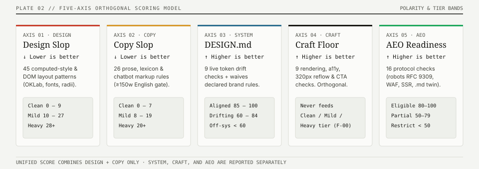

# slop-detect

**Deterministic 5-axis linter for web interfaces, design systems, and AI agent readiness.**

Score any landing page in real headless Chromium against default-template CSS and prose tells (`definitions@2026.11`), verify live DOM compliance against your [`DESIGN.md`](https://github.com/google-labs-code/design.md), check if AI search engines can read and cite your site (AEO), and generate a copy-paste remediation prompt.

<p>
  <a href="https://github.com/ravidsrk/slop-detect/actions"></a>
  <a href="https://www.npmjs.com/package/slop-detect"></a>
  <a href="https://www.npmjs.com/package/slop-detect-core"></a>
  <a href="https://slop-detect.com"></a>
  <a href="LICENSE"></a>
</p>

```text
$ npx slop-detect https://bolt.new https://news.ycombinator.com

https://bolt.new
  🟡 Mild  ·  score 24/100  ·  5 patterns triggered
  ✗ AI-default font stack (Inter / Geist / Space Grotesk)       (+8)
  ✗ Gradient-heavy backgrounds (5+ elements)                    (+4)
  ✗ Big colored box-shadow glows (purple/blue/pink)             (+4)
  ✗ Centered hero in generic sans (Inter-style)                 (+4)
  ✗ Perma dark mode + medium-grey body text                     (+4)

https://news.ycombinator.com
  🟢 Clean  ·  score 3/100  ·  1 pattern triggered
```

---

## Quickstart

```bash
# 1. Scan any URL from your terminal (Design + Copy + AEO + DESIGN.md)
npx slop-detect https://your-site.com --copy --aeo --design-md auto

# 2. Scan without downloading a local browser (via hosted API)
npx slop-detect https://your-site.com --copy --remote

# 3. Generate a remediation prompt for Claude Code / Cursor / v0
npx slop-detect https://your-site.com --copy --fix-prompt > fix.md

# 4. Wire MCP + Agent Skill + PostToolUse hooks into your project
npx slop-detect init
```

Or use the **MCP server** directly in `.mcp.json` / `.cursor/mcp.json` (pass `--local` to scan `localhost`):

```json
{
  "mcpServers": {
    "slop-detect": { "command": "npx", "args": ["-y", "slop-detect-mcp"] }
  }
}
```

Or gate pull requests with the **GitHub Action**:

```yaml
- uses: ravidsrk/slop-detect@v0.8.0
  with:
    url: ${{ steps.preview.outputs.url }}
    axes: 'design,copy'
    fail-under: 'B'
```

---

## The 45 patterns & 5-axis model

<p align="center">
  
</p>

All surfaces share the same deterministic engine (`definitions@2026.11`). Notice the **polarity**: lower is better for Design and Copy slop; higher is better for System, AEO, and Craft.

| Axis | Catalogue | Polarity | Tiers | Spec |
| --- | --- | --- | --- | --- |
| **Design Slop** | 45 CSS & DOM patterns (weight 0 review rules add no points) | **Lower is better** | `Clean` (`0–9`) · `Mild` (`10–27`) · `Heavy` (`28+`) | [`spec/patterns.md`](spec/patterns.md) |
| **Copy Slop** | 26 prose, vocabulary & chatbot-artifact rules | **Lower is better** | `Clean` (`0–7`) · `Mild` (`8–19`) · `Heavy` (`20+`) | [`spec/copy-axis.md`](spec/copy-axis.md) |
| **Craft Floor** | 11 rendering & accessibility hygiene checks | **Higher is better** | Orthogonal floor; never alters Design/Copy tiers | [`packages/core/src/craft.ts`](packages/core/src/craft.ts) |
| **System (`DESIGN.md`)** | 9 live DOM token compliance checks (`DESIGN.md` & DTCG `2025.10`) | **Higher is better** | `Aligned` (`80–100`) · `Drifting` (`50–79`) · `Off-system` (`<50`) | [`spec/system.md`](spec/system.md) |
| **AEO Readiness** | 16 HTTP, RFC 9309 `robots.txt`, `html.serverTextCoverage`, `.md` twin & discovery checks | **Higher is better** | `Eligible` (`80–100`) · `Partially Eligible` (`50–79`) · `Restricted` (`<50`) | [`spec/aeo.md`](spec/aeo.md) |

---

## Documentation

Full developer documentation lives in [**`docs/`**](docs/README.md):

| Guide | What It Covers |
| --- | --- |
| [**Getting Started**](docs/GETTING_STARTED.md) | 5-minute walkthrough across CLI, Web, API, fix prompts, and `slop-detect init` |
| [**CLI Guide**](docs/CLI_GUIDE.md) | All flags, presets (`strict`, `marketing`, `minimal`), `--copy-dir`, `--site`, SARIF/JUnit/agent outputs, and baseline ratcheting |
| [**AI Agents & MCP**](docs/AGENT_INTEGRATIONS.md) | Claude Code plugin & hooks, Cursor, Windsurf, Copilot, Codex, Agent Skills, and Remote MCP (`https://slop-detect.com/mcp`) |
| [**Generator & Builder Recipes**](docs/GENERATOR_RECIPES.md) | Pairing with [Anthropic `frontend-design`, Stitch & Impeccable](docs/GENERATOR_RECIPES.md) or [Lovable, v0, claude.ai & ChatGPT](docs/BUILDER_RECIPES.md) |
| [**CI/CD & Deploy Gates**](docs/CI_AND_DEPLOY_GATES.md) | GitHub Action (`api` & `local` modes + SARIF), [Vercel & Netlify gates](docs/DEPLOY_GATES.md), Lighthouse plugin, and Vale prose linting |
| [**Design Systems (`DESIGN.md`)**](docs/DESIGN_SYSTEMS.md) | Authoring, bootstrapping (`--init-tokens`), linting (`--lint-design-md`), diffing (`--diff-design-md`), and declared waivers |
| [**AEO & Agent Readiness**](docs/AEO_GUIDE.md) | All 16 AEO checks, RFC 9309 `robots.txt` search vs. training split, `/llms.txt`, `.md` twins, and `--emit-aeo-fixes` |
| [**SDK & REST API**](docs/SDK_AND_API.md) | Embedding `slop-detect-core` in Playwright/Puppeteer/Workers, custom rules (`compileRule`), and [HTTP API reference](apps/web/API.md) |
| [**Architecture & Calibration**](docs/ARCHITECTURE.md) | Monorepo structure, page-eval serialization, 5-axis math, [`CALIBRATION.md`](CALIBRATION.md), and [` ROADMAP.md`](ROADMAP.md) |

---

## Packages

| Package | npm / Usage | Description |
| --- | --- | --- |
| [`packages/core`](packages/core) | `npm i slop-detect-core` | Pure, zero-dependency 5-axis detection engine (workspace `@slop-detect/core`) |
| [`packages/cli`](packages/cli) | `npx slop-detect` | Playwright CLI runner, static HTML scanner, `DESIGN.md` linter, and SARIF/JUnit/agent reporters |
| [`packages/mcp`](packages/mcp) | `npx -y slop-detect-mcp` | Model Context Protocol server (`stdio` and `--local`) + Claude/Cursor PostToolUse hooks |
| [`packages/action`](packages/action) | `ravidsrk/slop-detect@v0.8.0` | Composite GitHub Action for preview URLs and local static builds |
| [`apps/web`](apps/web) | [slop-detect.com](https://slop-detect.com) | Cloudflare Pages web workbench, REST API (`/api/*`), and stateless Streamable HTTP MCP (`/mcp`) |
| [`skills/slop-detect`](skills/slop-detect) | `npx slop-detect init` | Portable [agentskills.io](https://agentskills.io) skill for Claude Code, Cursor, Copilot, Codex, and 20+ agents |

---

## Contributing & Support

```bash
git clone https://github.com/ravidsrk/slop-detect.git
cd slop-detect
bun install && bun run build && bun run test
```

- **Contributing:** See [`CONTRIBUTING.md`](CONTRIBUTING.md) for rule authoring and the held-out calibration promotion gate ([`CALIBRATION.md`](CALIBRATION.md)).
- **Support & Security:** Issues are tracked on GitHub ([`docs/SUPPORT.md`](docs/SUPPORT.md)); report vulnerabilities privately per [`docs/SECURITY.md`](docs/SECURITY.md).
- **Acknowledgments:** Built on empirical studies and rule sets from [Adrian Krebs](https://www.adriankrebs.ch/blog/design-slop/), [Meng To](https://x.com/MengTo), and [Paul Bakaus / Impeccable](https://github.com/pbakaus/impeccable).
- **License:** [MIT](LICENSE) © Ravindra Kumar
