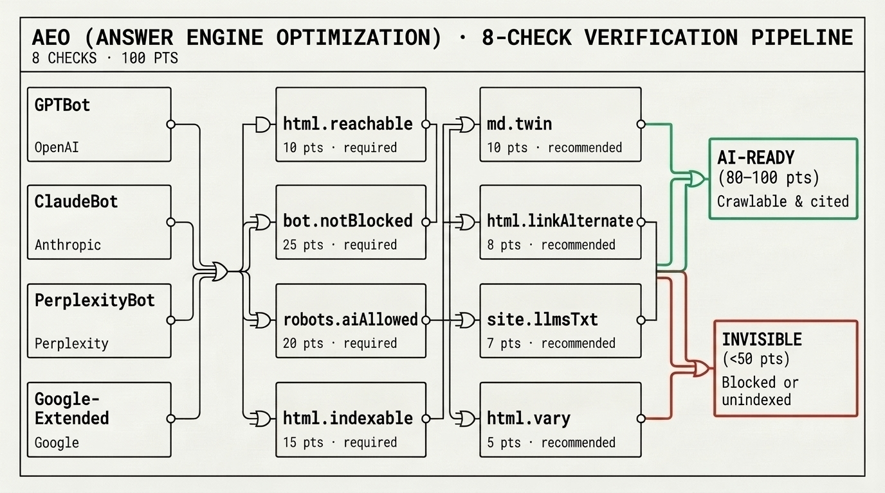

# Answer Engine Optimization (AEO) & Agent Readiness Guide

A page can look visually clean to a human and still be **completely invisible** to ChatGPT (`OAI-SearchBot` / `ChatGPT-User`), Claude (`Claude-SearchBot` / `Claude-User`), Perplexity (`PerplexityBot`), and Apple Intelligence because of a blanket `robots.txt` block, an edge WAF challenge, client-only JS rendering, or restrictive snippet controls.

The **AEO Axis** runs **16 deterministic HTTP, HTML, and protocol checks** ([`spec/aeo.md`](../spec/aeo.md)) to verify whether AI answer engines can fetch, read, and cite your page.

<p align="center">
  
</p>

---

## 1. Quick Audit & Fix Commands

```bash
# Audit any URL on the 16-check AEO axis
npx slop-detect https://your-site.com --aeo

# Or via the public HTTP API
curl -s -X POST https://slop-detect.com/api/aeo \
  -H 'Content-Type: application/json' \
  -d '{"url":"https://your-site.com"}' | jq

# Auto-generate starter robots.txt (RFC 9309 search vs. training split) and /llms.txt
npx slop-detect --emit-aeo-fixes ./public --origin https://your-site.com
```

> [!IMPORTANT]
> **Honest Crawler Identity:** The AEO scanner sends `SlopDetector-AEO/1.0 (+https://slop-detect.com/bot)`. It **never** impersonates `Googlebot`, `GPTBot`, or any vendor crawler (which would trigger reverse-DNS spoofing blocks on Cloudflare/Akamai). Instead, it parses your `robots.txt` per RFC 9309 against the live vendor crawler registry.

---

## 2. The 16 AEO Checks (`definitions@2026.11`)

**Polarity:** Higher is better (`0–100`).
- **`Eligible` (`80–100`)**: All required checks pass and primary prose is server-rendered.
- **`Partially Eligible` (`50–79`)**: Reachable, but missing recommended agent discovery or partial crawler blocks.
- **`Restricted` (`<50`)**: Blocked by `robots.txt`, WAF challenge, `noindex`, or empty SSR shell.

| Check ID | Weight | Severity | What It Verifies |
| --- | --- | --- | --- |
| `html.reachable` | 10 | `required` | Target URL returns HTTP `2xx` with `text/html` content-type. |
| `edge.access` | 20 | `required` | Edge/WAF (`cf-mitigated`, Turnstile, DataDome, Vercel challenge) does not block automated HTTP retrieval. |
| `robots.searchAllowed` | 20 | `required` | `robots.txt` (RFC 9309) permits AI **search & user-action** crawlers (`OAI-SearchBot`, `ChatGPT-User`, `Claude-SearchBot`, `Claude-User`, `PerplexityBot`, `Googlebot`, `bingbot`, `Applebot`). Blocking training-only crawlers (`GPTBot`, `ClaudeBot`, `Google-Extended`, `CCBot`) does **not** penalize this check! |
| `html.indexable` | 12 | `required` | No `noindex` in `<meta name="robots">` or `X-Robots-Tag`. |
| `ai.previewControls` | 8 | `required` | No `nosnippet`, `max-snippet:0`, or `noarchive` directives that prevent answer engines from quoting the page. |
| `html.serverTextCoverage` | 15 | `required` | Server-rendered HTML contains meaningful prose ($\ge 120$ words in `<main>`/`<article>`/`<body>`) without executing client JS. |
| `md.twin` | 6 | `recommended` | Validated `text/markdown` twin served at `<url>.md` or via `Accept: text/markdown` content negotiation (HTML 200 fallbacks are rejected). |
| `html.linkAlternate` | 3 | `recommended` | `<link rel="alternate" type="text/markdown" href="...">` in `<head>` or HTTP `Link` header. |
| `site.llmsTxt` | 2 | `recommended` | Valid `/llms.txt` at site root starting with an `# H1` title and Markdown links (not an SPA HTML 200 fallback). |
| `html.vary` | 4 | `recommended` | Responses using `Accept: text/markdown` negotiation include `Vary: Accept` so CDN caches do not poison browser HTML requests. |
| `ai.manipulation` | 0 | `info` | Scans for hidden prompt injection (`font-size:0`, `opacity:0`, white-on-white instructions, or AI manipulation links). |
| `agent.operability` | 0 | `info` | Interactive controls (`<button>`, `<a>`, `<input>`) carry accessible names and no full-bleed blocking modals. |
| `agent.discovery` | 0 | `info` | Checks `/.well-known/ard.json` (ARD v0.91), `/.well-known/mcp/server-card.json`, `/.well-known/agent-card.json` (A2A), and WebMCP. |
| `ai.usagePolicy` | 0 | `info` | Parses IETF AIPREF `Content-Usage` header, Cloudflare `Content-Signal` in `robots.txt`, and W3C `tdmrep.json`, flagging contradictions. |
| `content.dates` | 0 | `info` | Validates ISO-8601 `datePublished` / `dateModified` across JSON-LD, OpenGraph, and `<time datetime>`. |
| `jsonld.hygiene` | 0 | `info` | Verifies `<script type="application/ld+json">` parses as valid JSON and matches visible page headings. |

---

## 3. Copy-Paste Recipes to Score `100/100 Eligible`

### A. `robots.txt`: Allow AI Search & Citation While Blocking Training (`robots.searchAllowed`)

Many sites accidentally block `OAI-SearchBot` or `Claude-SearchBot` when they only meant to opt out of model training. Separate the two crawler classes in `/public/robots.txt`:

```txt
# 1. Allow AI Search, Citation & User-Triggered Retrieval
User-agent: OAI-SearchBot
User-agent: ChatGPT-User
User-agent: Claude-SearchBot
User-agent: Claude-User
User-agent: PerplexityBot
User-agent: Perplexity-User
User-agent: Applebot
User-agent: Googlebot
User-agent: bingbot
Allow: /
Content-Signal: ai-train=no, search=yes, ai-input=yes

# 2. Optional: Disallow Foundation Model Training-Only Crawlers
User-agent: GPTBot
User-agent: ClaudeBot
User-agent: Google-Extended
User-agent: Applebot-Extended
User-agent: CCBot
Disallow: /

User-agent: *
Allow: /
```

### B. Advertise a Markdown Twin (`md.twin`, `html.linkAlternate`, `html.vary`)

1. Publish a clean Markdown version of your landing/docs page at `/index.md` (with `Content-Type: text/markdown; charset=utf-8`).
2. Add the `<link rel="alternate">` tag to your HTML `<head>`:
   ```html
   <link rel="alternate" type="text/markdown" href="/index.md" title="Markdown twin" />
   ```
3. If you serve Markdown from the same URL when `Accept: text/markdown` is sent, always include:
   ```http
   Vary: Accept
   ```

### C. Publish `/llms.txt` and `/.well-known/ard.json` (`site.llmsTxt`, `agent.discovery`)

Place `/public/llms.txt` at your site root:
```markdown
# Your Product Name

> One-sentence summary of what your product does and who it serves.

## Documentation

- [Getting Started](https://your-site.com/docs.md): Quickstart and installation guide.
- [API Reference](https://your-site.com/openapi.json): OpenAPI 3.1 specification.
```

And if your site exposes an API or MCP server, publish `/.well-known/ard.json` (see [`apps/web/public/.well-known/ard.json`](../apps/web/public/.well-known/ard.json) for a live reference).
