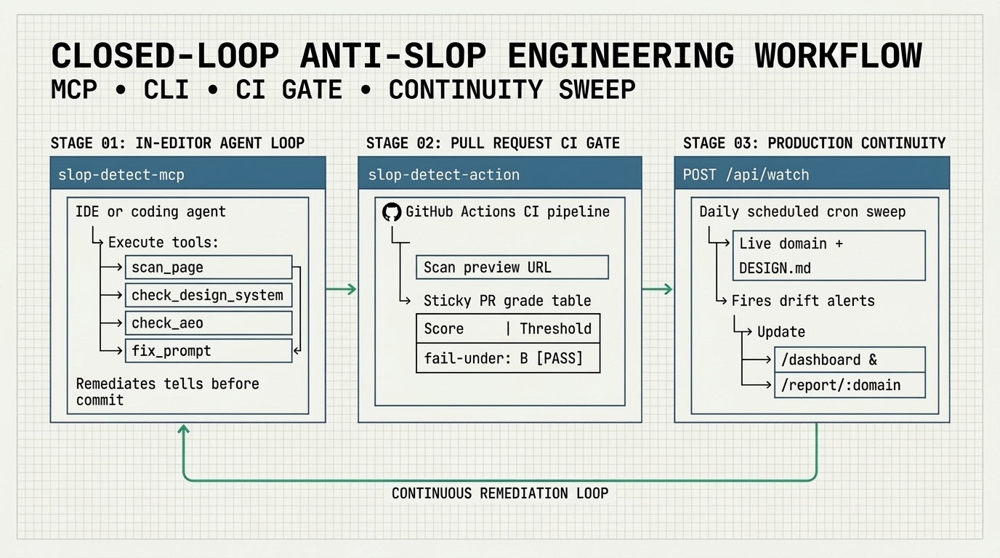

# AI Coding Agents, MCP & IDE Integrations

Slop Detector is designed to run **inside your coding agent's loop** so Claude Code, Cursor, Windsurf, GitHub Copilot, OpenAI Codex, v0, and Lovable can audit their own output in real headless Chromium and fix triggered tells before you ever review the PR.

<p align="center">
  
</p>

---

## 1. Which Integration Should I Use?

| Environment | Target URLs | Recommended Setup |
| --- | --- | --- |
| **Claude Code / Cursor / Windsurf (Local Dev)** | `http://localhost:*`, `file://`, AND public URLs | `npx slop-detect init` or `npx -y -p slop-detect -p slop-detect-mcp slop-detect-mcp --local` |
| **Claude Code / Cursor / Windsurf (Zero-Install)** | Public `https://` URLs & deploy previews | `npx -y slop-detect-mcp` (calls `https://slop-detect.com/api/*`) |
| **Web / Cloud Agents (`v0`, `Lovable`, `claude.ai`, `ChatGPT`)** | Public `https://` preview URLs (`*.vercel.app`, `*.lovable.app`) | Remote Streamable HTTP MCP: `https://slop-detect.com/mcp` |
| **Any [agentskills.io](https://agentskills.io)-compatible agent (20+ IDEs)** | Local or public URLs | Copy [`skills/slop-detect/SKILL.md`](../skills/slop-detect/SKILL.md) into `.claude/skills/` or `.cursor/skills/` |

> [!WARNING]
> **Localhost vs. Remote MCP:** The hosted API (`https://slop-detect.com/api/*` and `https://slop-detect.com/mcp`) enforces a strict SSRF guard and rejects `localhost`, `127.0.0.1`, and private network IPs (`422`). To scan `http://localhost:3000` or `file://`, always run the CLI or the npm server in local mode: `npx -y -p slop-detect -p slop-detect-mcp slop-detect-mcp --local` (the `slop-detect` Playwright runner is an optional peer, so name it).

---

## 2. One-Command Project Setup (`slop-detect init`)

From your project root:

```bash
npx slop-detect init
```

This creates or merges:
1. `.mcp.json` — registers `slop-detect-mcp --local` with the `slop-detect` runner
2. `.claude/settings.local.json` / `.cursor/hooks.json` / `.codex/hooks.json` — wires `slop-detect-hook` (`npx -y -p slop-detect -p slop-detect-mcp slop-detect-hook`) as a PostToolUse + Stop hook (pass `--no-hooks` to skip hooks)
3. `.slop/local-url` — the dev-server URL, when init can tell it from `package.json` (Astro, Next, Vite, SvelteKit, …) or you pass `--local-url`
4. `.claude/skills/slop-detect/SKILL.md` — installs the portable Agent Skill

The hook does nothing until a URL is set. Then it reports only new findings: when the score rises or a new pattern appears it exits 2 and Claude sees the message (Stop is blocked once so the agent can fix it). A scan that can't run never blocks; on Stop it shows you a note instead.

---

## 3. MCP Server (`slop-detect-mcp` & `https://slop-detect.com/mcp`)

Both the stdio package ([`packages/mcp`](../packages/mcp)) and the stateless Streamable HTTP endpoint (`https://slop-detect.com/mcp`) serve the same 7 tools from one contract ([`packages/core/src/mcp-tools.ts`](../packages/core/src/mcp-tools.ts)): same names, arguments and descriptions. Results are short summaries with compact structured content. Only the npm server keeps scans in memory, so `scan_id` works there; on the hosted endpoint pass the triggered `patterns` instead.

### Available MCP Tools

| Tool Name | Arguments | What It Returns |
| --- | --- | --- |
| `scan_page` | `{ url, axes?, preset?, design_md_url?, detail? }` | 0–100 score (`Clean`/`Mild`/`Heavy`), grade, and only the triggered patterns with evidence. `axes` adds `copy`/`craft`; `design_md_url` adds DESIGN.md compliance; `detail: "full"` returns the whole document. Never published. |
| `check_aeo` | `{ url }` | Answer Engine Optimization audit (`Eligible` / `Partially Eligible` / `Restricted`) with the failed checks. |
| `check_design_system` | `{ url?, design_md_url?, scan_id? }` | Live DOM compliance against `<origin>/DESIGN.md` or a custom `DESIGN.md` URL (`Aligned` / `Drifting` / `Off-system`). |
| `fix_prompt` | `{ url?, scan_id?, patterns?, axes?, preset?, design_md_url?, brief? }` | Copy-paste remediation prompt. Reuse a scan with `scan_id` (npm server) or `patterns`; `brief: true` gives a 120-word avoid list (generic when no page is given). |
| `lint_design_md` | `{ design_md }` | Static lint of `DESIGN.md` front matter (broken token refs, contrast < 4.5:1, orphaned tokens). No network call. |
| `diff_design_md` | `{ base_design_md, head_design_md }` | Token-level diff between two `DESIGN.md` files; flags breaking removals or value shifts. |
| `extract_design_system` | `{ url?, scan_id?, observed?, name?, format?: "design_md" \| "dtcg" \| "both" }` | Starter Google Labs `DESIGN.md` and/or W3C DTCG `2025.10` `tokens.json` from what a live page renders (or `observed` tokens). |

Missing or misspelled arguments return an error naming the field; older names (`content`, `base`/`head`, `designMd`, `copy: true`, `mode: "avoid"`) are still accepted.

### Interactive MCP App Resource (`ui://slop-detect/scorecard.html`)

Clients supporting the MCP Apps extension (`text/html;profile=mcp-app`) render an inline editorial-instrument scorecard directly in chat via `resources/read` on `ui://slop-detect/scorecard.html`.

---

## 4. IDE & Client Configuration

### Claude Code

**Option 1: Claude Code Plugin Marketplace**
```text
/plugin marketplace add ravidsrk/slop-detect
/plugin install slop-detect@slop-detect
```
*(Manifests live at [`.claude-plugin/marketplace.json`](../.claude-plugin/marketplace.json) and [`plugins/slop-detect/.claude-plugin/plugin.json`](../plugins/slop-detect/.claude-plugin/plugin.json).)*

**Option 2: CLI One-Liner**
```bash
# Public URLs (zero install)
claude mcp add slop-detect -- npx -y slop-detect-mcp

# Localhost dev servers (uses local Playwright via slop-detect)
claude mcp add slop-detect -- npx -y -p slop-detect -p slop-detect-mcp slop-detect-mcp --local
```

**Option 3: Regression hook (`slop-detect-hook`)**
`npx slop-detect init` writes this for you. To wire it by hand, set the dev-server URL (`SLOP_LOCAL_URL` or `.slop/local-url`) and add to `.claude/settings.local.json`:
```json
{
  "hooks": {
    "PostToolUse": [
      {
        "matcher": "Write|Edit|MultiEdit",
        "hooks": [
          {
            "type": "command",
            "command": "npx -y -p slop-detect -p slop-detect-mcp slop-detect-hook",
            "timeout": 180
          }
        ]
      }
    ],
    "Stop": [
      {
        "hooks": [
          {
            "type": "command",
            "command": "npx -y -p slop-detect -p slop-detect-mcp slop-detect-hook",
            "timeout": 180
          }
        ]
      }
    ]
  }
}
```

### Cursor

Add to `.cursor/mcp.json`:
```json
{
  "mcpServers": {
    "slop-detect": {
      "command": "npx",
      "args": ["-y", "-p", "slop-detect", "-p", "slop-detect-mcp", "slop-detect-mcp", "--local"]
    }
  }
}
```
Cursor Agent Plugins 1.0 manifests are also provided at [`plugin.json`](../plugin.json) and [`.cursor-plugin/plugin.json`](../.cursor-plugin/plugin.json).

### Windsurf

Add to `~/.codeium/windsurf/mcp_config.json`:
```json
{
  "mcpServers": {
    "slop-detect": {
      "command": "npx",
      "args": ["-y", "slop-detect-mcp"]
    }
  }
}
```

### VS Code (GitHub Copilot) & Agent Skills

Copy the portable Agent Skill into your workspace:
```bash
mkdir -p .github/copilot/skills
cp -r skills/slop-detect .github/copilot/skills/
```
Or for Microsoft Agent Package Manager (APM), see [`apm.yml`](../apm.yml).

---

## 5. Cloud Builders & Remote Connectors

- **Vercel `v0`, Lovable, claude.ai, and ChatGPT Developer Mode:** Connect directly to `https://slop-detect.com/mcp` (Streamable HTTP, no auth required). Step-by-step instructions: [**`BUILDER_RECIPES.md`**](./BUILDER_RECIPES.md).
- **Pairing with `frontend-design`, Stitch `DESIGN.md`, and Impeccable:** Prompting and verification workflows: [**`GENERATOR_RECIPES.md`**](./GENERATOR_RECIPES.md).
