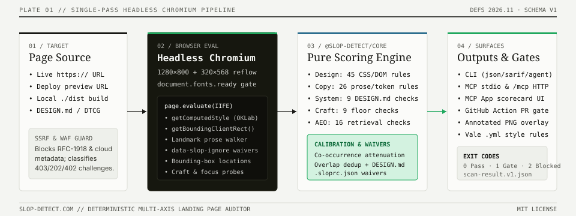
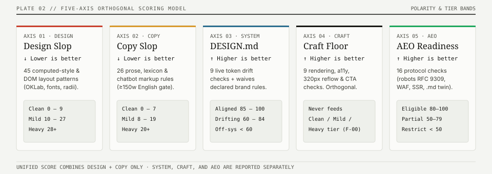
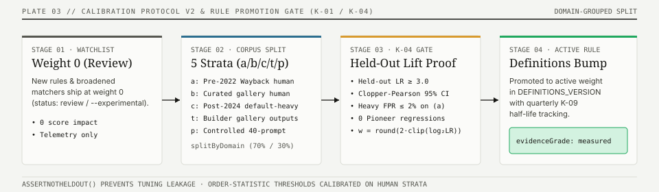

# Architecture, 5-Axis Scoring Model & Calibration

This document explains how Slop Detector is architected across the monorepo, how in-browser DOM evaluation works, how the five orthogonal axes are scored, and how rules are empirically calibrated.

<p align="center">
  
</p>

<p align="center">
  
</p>

---

## 1. Monorepo Architecture

`slop-detect` is a Bun + Turborepo monorepo built around a strict separation between **pure scoring logic** (`packages/core`) and **browser/network runners** (`packages/cli`, `packages/mcp`, `apps/web`):

```text
slop-detect/
├── packages/
│   ├── core/                            ← Pure TS engine (@slop-detect/core -> npm: slop-detect-core)
│   │   └── src/
│   │       ├── patterns.ts              ← 45 Design axis rules (DOM + computed styles)
│   │       ├── copyPatterns.ts          ← 26 Copy axis rules + Fightin' Words log-odds
│   │       ├── craft.ts                 ← 11 Craft floor checks (broken images, 320px reflow, focus, etc.)
│   │       ├── system.ts                ← 9 DESIGN.md & W3C DTCG 2025.10 compliance checks
│   │       ├── aeo.ts                   ← 16 AEO checks (RFC 9309 robots, SSR coverage, .md twins, ARD)
│   │       ├── color.ts                 ← CSS Color 4 parser & OKLab ΔE perceptual distance
│   │       ├── page-eval.ts             ← Self-contained browser evaluation script builder
│   │       ├── result-assembly.ts       ← Multi-axis score assembly & schema v1 stamping
│   │       └── fixes.ts                 ← Per-pattern remediation recipes & fix-prompt generator
│   ├── cli/                             ← Playwright runner, static HTML scanner & reporters
│   ├── mcp/                             ← Stdio + local MCP server & Claude/Cursor PostToolUse hooks
│   ├── action/                          ← Composite GitHub Action (API + local Chromium + SARIF)
│   ├── netlify-plugin-slop-detect/      ← Netlify onPostBuild deploy gate
│   └── lighthouse-plugin-slop-copy/     ← Lighthouse copy + HTML AEO plugin
├── apps/
│   └── web/                             ← Cloudflare Pages app, Hono/JSX routes, /api/* & /mcp
├── spec/                                ← Normative specifications & cross-surface conformance suite
└── schemas/                             ← JSON Schema draft 2020-12 (scan-result.v1.json)
```

---

## 2. How In-Browser DOM Evaluation Works

Static HTML/CSS linters miss what the user actually sees: Tailwind utility classes, CSS variables (`var(--primary)`), `oklch()` / `color-mix()` expressions, webfont fallbacks, and runtime DOM layout (`getBoundingClientRect()`).

1. **Page Settle Contract (`runner-wait.ts`)**: Both the Playwright CLI (`packages/cli/src/detector.ts`) and Cloudflare Browser Rendering (`apps/web/functions/api/scan.ts`) open the page in a `1280×800` viewport, wait for `domcontentloaded`, await `document.fonts.ready`, trigger intersection observers, and settle animations.
2. **Self-Contained Serialization (`buildPageEvaluateScript`)**: `packages/core/src/page-eval.ts` serializes color helpers (`createColorHelpers`), visibility helpers (`createVisibilityHelpers`), bundler-helper polyfills (`esbuildNamePolyfills`), and each pattern's `extract(ctx)` function into a single self-contained IIFE executed via `page.evaluate(...)`.
3. **Pure Assembly (`assembleScanResult`)**: The browser returns a JSON-serializable signal bundle (`signals`, `textContext`, `craftContext`, `systemContext`, `blockedContext`). `assembleScanResult` runs outside the browser to compute scores, tiers, letter grades, verdicts, and schema-stamped results.

---

## 3. Mathematical Scoring Model

### Design & Copy Axes (`combineAxes`)

- **Design Score**: $\text{score}_{\text{design}} = \min\left(100, \sum_{p \in \text{triggered}} w_p\right)$
  - Tiers: `Clean` ($0\text{–}9$), `Mild` ($10\text{–}27$), `Heavy` ($\ge 28$).
- **Copy Score**: $\text{score}_{\text{copy}} = \min\left(100, \sum_{c \in \text{triggered}} w_c\right)$
  - Tiers: `Clean` ($0\text{–}7$), `Mild` ($8\text{–}19$), `Heavy` ($\ge 20$).
  - Prose gates: Statistical copy rules require $\ge 150$ extracted prose words and English language detection (`thin: true` pages below 40 words never fire statistical prose rules).
- **Unified Multi-Axis Score**:
  $$\text{unifiedScore} = \min\left(100, \max(\text{score}_{\text{design}}, \text{score}_{\text{copy}}) + 6 \times \max(0, N_{\text{dirty}} - 1)\right)$$
  where $N_{\text{dirty}}$ is the count of axes scoring outside `Clean`.

### Why Craft Floor Is Orthogonal

A bespoke human-made site can have a broken image or a missing focus indicator, while a freshly generated template can pass basic rendering checks. Therefore, **Craft Floor (`CRAFT_CHECKS`) never adds points to Design or Copy slop and never changes `Clean` / `Mild` / `Heavy`**. It is reported on its own `0–100` scale (`result.craft`).

---

## 4. Calibration Protocol v2 & Rule Promotion Gate

<p align="center">
  
</p>

All new rules (and changes that broaden an existing rule) ship at **weight `0` (`status: 'review'`)** so they surface evidence without changing any site's score or tier. To graduate to a positive weight (`status: 'active'`), a rule must clear the **K-04 Promotion Gate** documented in [**`CALIBRATION.md`**](../CALIBRATION.md):

1. **Domain-Grouped 70/30 Split**: Thresholds are tuned on the 70% training split and evaluated once on the locked 30% held-out split.
2. **Positive Likelihood Ratio ($\text{LR}_+ \ge 3.0$)**: Held-out $\text{LR}_+ = \text{TPR} / \text{FPR} \ge 3.0$ with Clopper–Pearson 95% confidence intervals.
3. **Zero Pioneer Regressions**: Must not push any canonical design-system pioneer fixture (`packages/core/test/pioneers.test.js`) out of `Clean`.
4. **Cross-Surface Conformance (`spec/conformance.json`)**: Verified in CI by `packages/core/test/conformance.test.js`.
