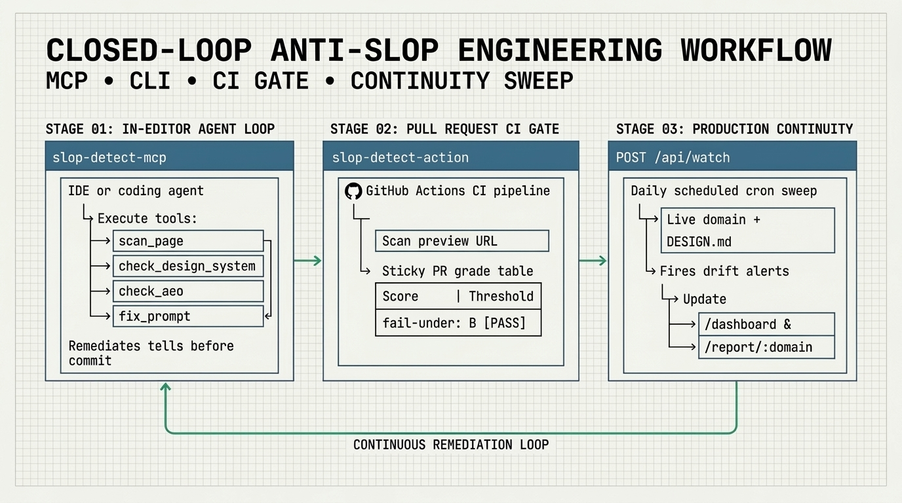

# CI/CD, Deploy Gates, Lighthouse & Vale Integration

Prevent design-slop patterns, copy tells, `DESIGN.md` token drift, and AEO regressions from merging into `main` or promoting to production.

<p align="center">
  
</p>

---

## 1. GitHub Action (`ravidsrk/slop-detect`)

The composite GitHub Action ([`action.yml`](../action.yml) / [`packages/action`](../packages/action)) supports two execution modes:
- **`mode: api` (default)**: Zero-install, scans a public deploy-preview URL via `https://slop-detect.com/api/scan` and posts a sticky PR comment.
- **`mode: local`**: Runs headless Chromium inside the GitHub Actions runner against a local static directory (`static-dir: ./dist`) or a `http://localhost` server.

### Recipe A: Scan a Deploy Preview URL & Post Sticky PR Comment

```yaml
name: Slop Detect
on:
  pull_request:

permissions:
  contents: read
  pull-requests: write

jobs:
  slop:
    runs-on: ubuntu-latest
    steps:
      - name: Audit Preview URL
        uses: ravidsrk/slop-detect@v0.9.0
        with:
          url: ${{ env.PREVIEW_URL }}
          axes: 'design,copy'
          design-md: 'auto'
          aeo: 'true'
          fail-under: 'B' # Fail if grade drops below B (or pass a max numeric score like '27')
```

### Recipe B: Local Static Build + SARIF Upload to GitHub Code Scanning

```yaml
name: Slop Detect Local + SARIF
on:
  pull_request:

permissions:
  contents: read
  pull-requests: write
  security-events: write

jobs:
  slop-local:
    runs-on: ubuntu-latest
    steps:
      - uses: actions/checkout@v4
      - uses: actions/setup-node@v4
        with:
          node-version: 22
      - run: npm ci && npm run build

      - name: Run Slop Detect Locally & Upload SARIF
        uses: ravidsrk/slop-detect@v0.9.0
        with:
          mode: 'local'
          static-dir: './dist'
          axes: 'design,copy'
          design-md: './DESIGN.md'
          fail-under: '27'
          sarif: 'slop-detect.sarif'
          upload-sarif: 'true'
```

### Recipe C: Baseline Regression Ratchet (`fail-on-regression`)

Compare the PR preview against production so existing pages never get worse:

```yaml
      - name: Ratchet Against Production Baseline
        uses: ravidsrk/slop-detect@v0.9.0
        with:
          url: ${{ steps.preview.outputs.url }}
          baseline-url: 'https://your-production-site.com'
          fail-on-regression: 'true'
```

### Action Inputs & Outputs

| Input | Default | Description |
| --- | --- | --- |
| `url` | — | URL to scan (required unless `static-dir` is used in `local` mode). |
| `mode` | `'api'` | `'api'` (hosted scanner) or `'local'` (Playwright Chromium in runner). |
| `static-dir` | `''` | Local build folder (`./dist`, `./out`) served and scanned in `local` mode. |
| `axes` | `'design'` | `'design'`, `'design,copy'`, or `'all'`. |
| `design-md` | `''` | `'auto'`, a local path (`./DESIGN.md`), or a URL. |
| `aeo` | `'false'` | Set `'true'` to run the 16-check AEO audit. |
| `fail-under` | `''` | Max allowed slop score (`'9'`, `'27'`) or minimum letter grade (`'B'`). |
| `baseline-url` | `''` | Baseline URL for regression comparison. |
| `fail-on-regression` | `'false'` | Fail if the score regresses relative to `baseline-url`. |
| `sarif` | `''` | Path to write SARIF 2.1.0 output (`slop.sarif`). |
| `upload-sarif` | `'false'` | Automatically upload SARIF to GitHub Code Scanning (`codeql-action/upload-sarif`). |
| `comment` | `'true'` | Upsert a sticky PR comment with the full scorecard. |

---

## 2. Vercel Deployment Checks

Gate production promotion (`deployment.promoted`) on a GitHub Action triggered by `deployment_status`. Full walkthrough: [**`DEPLOY_GATES.md`**](./DEPLOY_GATES.md#1-vercel-deployment-checks-via-github-actions).

---

## 3. Netlify Build Plugin (`netlify-plugin-slop-detect`)

The [`packages/netlify-plugin-slop-detect`](../packages/netlify-plugin-slop-detect) plugin runs during `onPostBuild`, reports to the Netlify deploy summary via `utils.status.show`, and halts failing builds via `utils.build.failBuild`:

```toml
# netlify.toml
[[plugins]]
  package = "./packages/netlify-plugin-slop-detect"
  [plugins.inputs]
    failOn = "heavy"
    failUnderScore = 27
    axes = ["design", "copy"]
    designMd = "./DESIGN.md"
```

---

## 4. Lighthouse Plugin (`lighthouse-plugin-slop-copy`)

Already running Lighthouse CI? Add [`packages/lighthouse-plugin-slop-copy`](../packages/lighthouse-plugin-slop-copy) to audit the **Copy axis**, chatbot paste artifacts (`data-start`/`data-end`, `utm_source=chatgpt.com`), and **HTML-level AEO checks** directly from Lighthouse's `MainDocumentContent` artifact:

```bash
lhci collect --url=https://your-site.com --settings.plugins=lighthouse-plugin-slop-copy
```

> [!NOTE]
> The Lighthouse plugin audits **Copy + HTML-level AEO only**. Computed-style Design and Craft checks require `slop-detect`'s DOM evaluate script.

---

## 5. Vale Prose Linter (`styles/SlopDetect/`)

Lint Markdown docs and marketing copy in your editor or CI with [Vale](https://vale.sh). Deterministic Vale rules are exported from `COPY_PATTERNS` into [`styles/SlopDetect/`](../styles/SlopDetect) via [`scripts/export-vale.mjs`](../scripts/export-vale.mjs):

```ini
# .vale.ini
StylesPath = styles
MinAlertLevel = suggestion

[*.{md,mdx,html}]
BasedOnStyles = SlopDetect
```

- **Error tier:** Hard artifacts (`chatbot_markup_leak`, `chatbot_reply_residue`, `ai_referral_utm_links`, `unfilled_placeholders`, `fake_bold_math_alnum`, `hidden_tag_characters`, `invisible_characters`).
- **Suggestion tier:** Phrase and vocabulary rules (`buzzword_density`, `antithesis_construction`, `filler_openers`, `formulaic_closers`, `whether_youre`).
- Re-generate after updating `packages/core/src/copyPatterns.ts`:
  ```bash
  node scripts/export-vale.mjs
  ```
