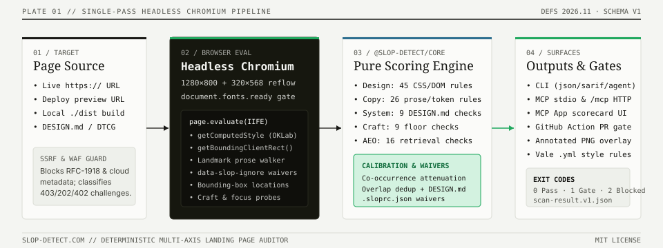

# CLI Guide (`slop-detect`)

`slop-detect` is the Playwright-powered command-line runner for local development, static build verification, `DESIGN.md` token workflows, and CI/CD pipelines.

<p align="center">
  
</p>

---

## 1. Installation & Browser Management

```bash
# Run directly with npx
npx slop-detect https://your-site.com

# Or install globally
npm install -g slop-detect
slop-detect https://your-site.com
```

### How Browser Provisioning Works

| Mode | Command / Env Var | How It Runs |
| --- | --- | --- |
| **Local Playwright (default)** | `slop-detect https://...` | Lazily installs Playwright Chromium (`1.65.0`) on first scan. Works on `http://localhost`, `http://127.0.0.1`, `file://`, and public URLs. |
| **Pre-installed Chromium (CI)** | `SKIP_PLAYWRIGHT_DOWNLOAD=1 slop-detect ...` | Uses the Playwright Chromium already installed in CI (`npx playwright install --with-deps chromium`), preventing download logs from polluting stdout. |
| **Remote API (Zero Browser)** | `slop-detect https://... --remote` | Delegates the scan to `POST https://slop-detect.com/api/scan`. Requires zero local Chromium install (public URLs only). |

---

## 2. Core Scanning Workflows

### Single & Multi-URL Comparison

Pass one URL for a detailed breakdown, or multiple URLs to print a side-by-side comparison table:

```bash
# Single URL across design + copy + craft + AEO
slop-detect https://example.com --copy --craft --aeo

# Compare multiple URLs in a terminal table
slop-detect https://bolt.new https://v0.dev https://linear.app --copy
```

### Scoring Presets (`--preset`)

Instead of scoring all 45 design patterns, filter to a curated subset:

```bash
slop-detect https://example.com --preset strict      # Only high-weight tells (weight >= 5); lowest false-positive gate
slop-detect https://example.com --preset marketing   # Fonts, colors, gradients, and hero treatment
slop-detect https://example.com --preset minimal     # The 3 signature tells: slop fonts + purple accent + gradient text
slop-detect https://example.com --preset editorial   # Editorial/publication layout focus
slop-detect https://example.com --preset devtool     # Developer tool / documentation landing page focus
```

When using a non-`full` preset, the JSON output still records `fullScore` (the unfiltered design score) alongside the preset-filtered `score`.

### Site-Wide Crawling (`--site` & `--site-copy`)

Audit up to $N$ internal pages discovered from same-origin links:

```bash
# Full rendered Chromium scan across up to 5 internal pages
slop-detect https://example.com --site 5

# Fast HTTP-only copy-axis crawl across up to 10 internal pages (no browser needed)
slop-detect https://example.com --site-copy 10
```

### Static HTML Build Directory (`--copy-dir`)

Audit built HTML files on disk (`dist/`, `out/`, `.next/server/app`, `_site/`) for copy-axis tells and chatbot markup artifacts without starting a server or launching Chromium:

```bash
slop-detect --copy-dir ./dist
```

### Multi-Run Variance Aggregation (`--runs` & `--aggregate`)

For pages with late-hydrating animations or async fonts, run $N$ consecutive passes and aggregate with `median` or `pessimistic` (max):

```bash
slop-detect https://example.com --runs 3 --aggregate pessimistic
```

---

## 3. Output Formats & Reporters

`slop-detect` supports both live scanning and re-formatting a saved JSON scan result (`slop-detect result.json --format <fmt>`):

| Flag | Output Format | Best For |
| --- | --- | --- |
| *(default)* | Human-readable ANSI table | Interactive terminal use |
| `--json` | `schemas/scan-result.v1.json` | Piping to `jq`, saving baselines, programmatic analysis |
| `--format agent` | Ultra-compact 1-line-per-finding text | AI coding agent context windows (uses ~75% fewer tokens than JSON) |
| `--format sarif` | SARIF 2.1.0 JSON | GitHub Code Scanning / Security tab annotations |
| `--format github` | `::error` / `::warning` workflow commands | Inline GitHub Actions PR diff annotations |
| `--format junit` | JUnit XML (`<testsuite>`) | CircleCI, Jenkins, Buildkite, GitLab test reports |
| `--format gitlab` | GitLab Code Quality JSON | GitLab MR widget quality diffs |
| `--fix-prompt` | Full Markdown remediation prompt | Pasting into Claude, Cursor, Windsurf, or v0 |
| `--brief <result.json>` | Compact ≤120-word avoid-list | Prepending to an agent prompt without bloating context |

```bash
# Save a full scan once, then emit multiple formats without re-scanning:
slop-detect https://example.com --copy --json > result.json
slop-detect result.json --format agent
slop-detect result.json --format sarif > slop.sarif
slop-detect --brief result.json
```

---

## 4. Baselines, Diffing & CI Ratcheting

Prevent a codebase from backsliding even if you aren't at `Clean (0–9)` yet:

```bash
# 1. Save your current score as the baseline on main
slop-detect https://staging.example.com --copy --save-baseline .slop/baseline.json

# 2. On a PR, compare against the baseline and fail only on regression
slop-detect https://preview-pr-42.example.com --copy \
  --compare-to .slop/baseline.json \
  --fail-on-regression

# 3. Or diff two saved scan JSON files offline
slop-detect --diff-scan before.json after.json
```

> [!NOTE]
> `--compare-to` enforces `definitionsVersion` parity: if `baseline.json` was recorded under a different `DEFINITIONS_VERSION`, the CLI refuses the comparison rather than reporting a false delta.

---

## 5. `DESIGN.md`, DTCG Tokens & AEO Generators

```bash
# Verify a live page against its declared DESIGN.md
slop-detect https://example.com --design-md auto
slop-detect http://localhost:3000 --design-md ./DESIGN.md

# Bootstrap W3C DTCG 2025.10 tokens.json from a live page's rendered DOM
slop-detect https://example.com --init-tokens > tokens.json

# Static lint a DESIGN.md file (no browser, exits 1 on errors)
slop-detect --lint-design-md ./DESIGN.md

# Diff two DESIGN.md files for breaking token removals/changes (exits 1 on breaking change)
slop-detect --diff-design-md main-DESIGN.md pr-DESIGN.md

# Generate RFC 9309 robots.txt and /llms.txt starter files for AEO
slop-detect --emit-aeo-fixes ./public --origin https://example.com
```

See [**Design Systems Guide (`DESIGN_SYSTEMS.md`)**](./DESIGN_SYSTEMS.md) and [**AEO Guide (`AEO_GUIDE.md`)**](./AEO_GUIDE.md) for deep dives.

---

## 6. Exit Codes Contract

Every CLI command follows a strict 3-state exit code contract (documented in [`schemas/README.md`](../schemas/README.md)):

| Exit Code | Meaning |
| --- | --- |
| `0` | Scan completed and passed all active gates (`--fail-on`, `--fail-under`, `--fail-on-regression`). |
| `1` | Scan completed, and the page breached a gate threshold (or `--lint-design-md` / `--diff-design-md` found errors). |
| `2` | **Scan could not run** (blocked by bot wall/WAF, navigation timeout, empty render, definitions-version mismatch, or invalid CLI flag). **Exit `2` is never a Clean score.** |
