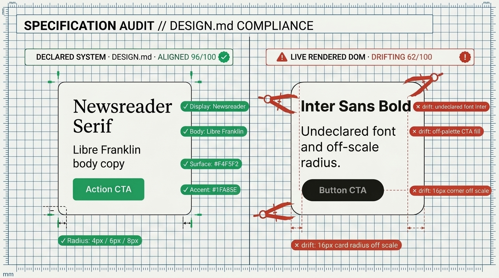

# Design Systems Guide (`DESIGN.md` & W3C DTCG `2025.10`)

The **System Axis** answers a question that absolute template detectors cannot: **"Does this live page honor its own declared design system?"**

<p align="center">
  
</p>

By checking rendered DOM styles against a site's declared [`DESIGN.md`](https://github.com/google-labs-code/design.md) or W3C Design Tokens Community Group ([DTCG `2025.10`](https://www.w3.org/TR/2025/CRD-design-tokens-format-module-20251028/)) `tokens.json`, Slop Detector catches off-palette CTA colors, undeclared fonts, rogue corner radii, and off-grid spacing—while automatically waiving intentional brand choices so bespoke design systems are never penalized as "slop."

---

## 1. Quick Commands

```bash
# 1. Verify a live page against <origin>/DESIGN.md or a local file
npx slop-detect https://your-site.com --design-md auto
npx slop-detect http://localhost:3000 --design-md ./DESIGN.md

# 2. Bootstrap a W3C DTCG 2025.10 tokens.json from any live URL's rendered DOM
npx slop-detect https://your-site.com --init-tokens > tokens.json

# 3. Static lint a DESIGN.md file (checks contrast >= 4.5:1, broken refs, orphaned tokens)
npx slop-detect --lint-design-md ./DESIGN.md

# 4. Diff two DESIGN.md files in CI (exits 1 if a token is removed or changed)
npx slop-detect --diff-design-md main-DESIGN.md pr-DESIGN.md
```

---

## 2. How the System Axis Scores a Page

The System axis evaluates **9 checks** ([`spec/system.md`](../spec/system.md)) against the rendered DOM inside headless Chromium. **Higher is better** (`0–100`):

- **`Aligned` (`80–100`)**: The live DOM honors the declared typography, palette, radii, shadows, and spacing scale.
- **`Drifting` (`50–79`)**: Minor token drift (e.g., an undeclared secondary font or a card radius off the scale).
- **`Off-system` (`<50`)**: Major divergence between `DESIGN.md` and the rendered page.

| Check ID | Weight | What It Verifies in the Live DOM |
| --- | --- | --- |
| `fonts.declared` | 25 | Every rendered heading, body, and mono `font-family` appears in `DESIGN.md`. |
| `colors.cta` | 20 | Primary button/CTA fills match declared palette tokens within perceptual OKLab $\Delta E_{\text{OK}} \le 0.03$. |
| `colors.surface` | 15 | Page and card background surfaces match declared surface tokens ($\Delta E_{\text{OK}} \le 0.03$). |
| `colors.text` | 15 | Primary and muted text colors match declared ink tokens ($\Delta E_{\text{OK}} \le 0.03$). |
| `radii.scale` | 15 | Card, button, and input `border-radius` values sit within $\pm 2\text{px}$ of the declared radius scale. |
| `shadows.scale` | 10 | Box-shadow elevations match declared shadow tokens (or remain `none` when shadows are forbidden). |
| `coverage.color` | 0 *(info)* | Share of all rendered DOM colors covered by declared tokens. |
| `coverage.font` | 0 *(info)* | Share of rendered text nodes covered by declared font families. |
| `coverage.spacing` | 0 *(info)* | Share of rendered padding/gap values aligned to the declared spacing grid. |

> [!TIP]
> **Perceptual CSS Color 4 Matching:** Both `DESIGN.md` and the browser extractor normalize `rgb()`, `hsl()`, `oklch()`, `oklab()`, `color(display-p3 ...)`, and `color-mix()` into **OKLab** so `oklch(0.62 0.19 145)` and its hex equivalent `#22c55e` match with zero false drift.

---

## 3. Authoring a `DESIGN.md`

Place `DESIGN.md` at your site root (`public/DESIGN.md` in Next.js/Astro/Vite so it is served at `https://your-site.com/DESIGN.md`). See [`DESIGN.md`](../DESIGN.md) in this repo or [`examples/nextjs-app-router/public/DESIGN.md`](../examples/nextjs-app-router/public/DESIGN.md) for complete reference examples:

```markdown
---
name: Acme Editorial Instrument
specVersion: "0.1"
colors:
  background: "#F4F5F2"
  surface: "#ECEEE9"
  text: "#111310"
  muted: "#4A5147"
  accent: "#166534"
fonts:
  display: "Newsreader"
  sans: "Libre Franklin"
  mono: "JetBrains Mono"
radii:
  sm: "4px"
  md: "6px"
  lg: "8px"
spacing:
  xs: "4px"
  sm: "8px"
  md: "16px"
  lg: "24px"
  xl: "48px"
---

# Acme Design System

## Typography
- **Display (`Newsreader`)**: Headings H1–H2.
- **Body (`Libre Franklin`)**: Prose and UI controls.
- **Mono (`JetBrains Mono`)**: Data tables, badges, and code.

## Color Palette
- **Paper (`#F4F5F2`)** and **Panel (`#ECEEE9`)** with **Ink (`#111310`)**.
- **Primary CTA (`#166534`)**: Forest green fill with `#F4F5F2` text (contrast 7.1:1).
```

---

## 4. Using W3C DTCG `2025.10` `tokens.json`

`slop-detect-core` natively parses W3C Design Tokens Community Group Final Report (`2025.10`) files, including:
- Object-valued `$value` colors (`{ "colorSpace": "srgb", "components": [0.08, 0.4, 0.2], "hex": "#166534" }`)
- `{group.token}` aliases and JSON Pointer `$ref`s
- `$root` tokens and `$extends` group inheritance
- Cycle detection and lenient import mode for legacy Tokens Studio / Penpot exports

```ts
import { parseDtcgTokens, extractDtcgTokens } from 'slop-detect-core';

const parsed = parseDtcgTokens(fs.readFileSync('tokens.json', 'utf8'));
```

---

## 5. Declared Design Waivers (`waivedByDesignMd`)

What if your brand intentionally uses `Space Grotesk`, a dark `#090a0f` canvas, or a violet brand primary?
1. **Automatic `DESIGN.md` Waiver:** When you pass `--design-md ./DESIGN.md` (or `designMd: true` in the API) and the page's observed token matches your declared `DESIGN.md` token, `applyDeclaredDesignWaivers()` automatically waives overlapping default-template rules (`slop_fonts`, `purple_accent`, `perma_dark_mode`, `cream_default_bg`) and records `waivedByDesignMd: true` while preserving `rawScore` for transparency.
2. **Inline HTML Waiver Comments:** You can also waive a specific rule in HTML with a documented reason:
   ```html
   <!-- slop-detect:ignore bento_grid reason="Product feature matrix uses asymmetric 4-cell spec table" -->
   ```
   > **Note:** Craft-floor checks (broken images, horizontal overflow at 320px, missing focus rings) can **never** be waived.
