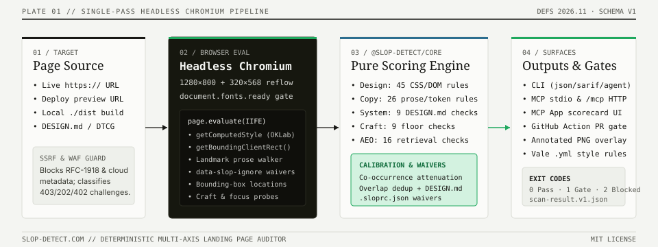
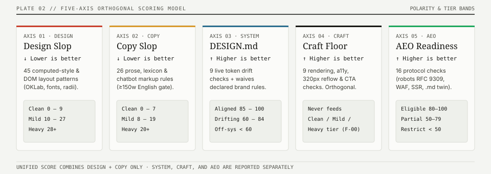

# Slop Detector Documentation

> **Developer documentation for `slop-detect` (`v0.9.0` · `definitions@2026.11`)** — the open-source, deterministic 5-axis auditing instrument for web interfaces, design systems, and AI agent readiness.

  

  

---

## Choose Your Path

| What you want to do | Start here |
| --- | --- |
| **Run your first scan in 60 seconds** (Terminal, Web, API, or MCP) | [**5-Minute Quickstart (`GETTING_STARTED.md`)**](./GETTING_STARTED.md) |
| **Use the CLI (`npx slop-detect`)** for local dev, batch URLs, static builds, SARIF/JUnit output, or baseline ratcheting | [**Complete CLI Guide (`CLI_GUIDE.md`)**](./CLI_GUIDE.md) |
| **Connect AI coding agents** (Claude Code, Cursor, Windsurf, Copilot, Codex, Gemini CLI) via MCP, Plugins, Skills, or Hooks | [**AI Agent & IDE Integrations (`AGENT_INTEGRATIONS.md`)**](./AGENT_INTEGRATIONS.md) |
| **Pair with AI page builders & design skills** (v0, Lovable, Bolt, Anthropic `frontend-design`, Stitch, Impeccable) | [**Generator Recipes (`GENERATOR_RECIPES.md`)**](./GENERATOR_RECIPES.md) · [**Builder Recipes (`BUILDER_RECIPES.md`)**](./BUILDER_RECIPES.md) |
| **Gate PRs and deployments in CI/CD** (GitHub Actions, Vercel Deployment Checks, Netlify Plugin, Lighthouse, Vale) | [**CI/CD & Deploy Gates (`CI_AND_DEPLOY_GATES.md`)**](./CI_AND_DEPLOY_GATES.md) · [**Deploy Gate Recipes (`DEPLOY_GATES.md`)**](./DEPLOY_GATES.md) |
| **Enforce a `DESIGN.md` or W3C DTCG `2025.10` `tokens.json` design system** (extract, lint, diff, live DOM compliance & waivers) | [**Design Systems Guide (`DESIGN_SYSTEMS.md`)**](./DESIGN_SYSTEMS.md) |
| **Make your site readable & citable by AI search engines** (`robots.txt`, `/llms.txt`, `.md` twins, ARD discovery) | [**AEO & Agent Readiness Guide (`AEO_GUIDE.md`)**](./AEO_GUIDE.md) |
| **Embed the pure JS/TS engine (`slop-detect-core`)** in Playwright/Puppeteer/Workers or call the **REST API** | [**SDK & REST API Guide (`SDK_AND_API.md`)**](./SDK_AND_API.md) · [**Full HTTP Endpoint Reference (`../apps/web/API.md`)**](../apps/web/API.md) |
| **Understand the 5-axis scoring model, write a custom rule, or inspect calibration data** | [**Architecture (`ARCHITECTURE.md`)**](./ARCHITECTURE.md) · [**Scoring Spec (`../spec/README.md`)**](../spec/README.md) · [**Calibration (`../CALIBRATION.md`)**](../CALIBRATION.md) |
| **Self-host `slop-detect.com` on Cloudflare Pages** or operate KV / Browser Rendering / monitoring | [**Self-Hosting & Operations (`operations/README.md`)**](./operations/README.md) |

---

## The Five Orthogonal Axes at a Glance

  

Every surface (`slop-detect` CLI, `slop-detect-mcp`, GitHub Action, `slop-detect-core`, and `https://slop-detect.com`) executes the **exact same engine** (`@slop-detect/core`, published to npm as `slop-detect-core`):

| Axis | Catalogue (`2026.11`) | Polarity | Tiers | Spec Reference |
| --- | --- | --- | --- | --- |
| **1. Design Slop** | 45 CSS & DOM patterns (weight 0 review rules add no points) | **Lower is better** (`0–100`) | `Clean` (`0–9`) · `Mild` (`10–27`) · `Heavy` (`28+`) | [`spec/patterns.md`](../spec/patterns.md) |
| **2. Copy Slop** | 26 prose, vocabulary & artifact rules (150-word & EN gates) | **Lower is better** (`0–100`) | `Clean` (`0–7`) · `Mild` (`8–19`) · `Heavy` (`20+`) | [`spec/copy-axis.md`](../spec/copy-axis.md) |
| **3. Craft Floor** | 11 rendering & accessibility hygiene checks (orthogonal floor) | **Higher is better** (`0–100`) | Never feeds `Clean` / `Mild` / `Heavy` slop score | [`packages/core/src/craft.ts`](../packages/core/src/craft.ts) |
| **4. System (`DESIGN.md`)** | 9 live DOM token compliance checks (`DESIGN.md` & DTCG `2025.10`) | **Higher is better** (`0–100`) | `Aligned` (`80–100`) · `Drifting` (`50–79`) · `Off-system` (`<50`) | [`spec/system.md`](../spec/system.md) |
| **5. AEO Readiness** | 16 HTTP, `robots.txt`, SSR prose, Markdown twin & discovery checks | **Higher is better** (`0–100`) | `Eligible` (`80–100`) · `Partially Eligible` (`50–79`) · `Restricted` (`<50`) | [`spec/aeo.md`](../spec/aeo.md) |

> [!IMPORTANT]
> **Methodological Guardrail ([K-06](https://github.com/ravidsrk/slop-detect/issues/301)):** Slop Detector measures how many **default-template CSS and prose patterns** a page matches, how closely it honors its declared `DESIGN.md`, and whether automated retrieval can parse it. It **never** claims whether a page or its author is "AI-generated."

---

## Monorepo Package & Surface Map

| Surface / Directory | Package Name | What It Does | README |
| --- | --- | --- | --- |
| [`packages/core/`](../packages/core) | `slop-detect-core` *(workspace `@slop-detect/core`)* | Pure, zero-dependency 5-axis detection engine, `DESIGN.md` / DTCG parser, AEO runner, and fix-prompt builder | [`packages/core/README.md`](../packages/core/README.md) |
| [`packages/cli/`](../packages/cli) | `slop-detect` | Playwright-powered CLI scanner, static HTML auditor, `DESIGN.md` linter/extractor, and SARIF/JUnit/agent reporter | [`packages/cli/README.md`](../packages/cli/README.md) |
| [`packages/mcp/`](../packages/mcp) | `slop-detect-mcp` | Model Context Protocol (MCP) server for Claude Code, Cursor, Windsurf, and remote Streamable HTTP (`/mcp`) | [`packages/mcp/README.md`](../packages/mcp/README.md) |
| [`packages/action/`](../packages/action) | `ravidsrk/slop-detect` | Composite GitHub Action (`api` and `local` Chromium modes, sticky PR comments, SARIF upload, baseline ratcheting) | [`packages/action/README.md`](../packages/action/README.md) |
| [`packages/netlify-plugin-slop-detect/`](../packages/netlify-plugin-slop-detect) | `netlify-plugin-slop-detect` | Netlify `onPostBuild` deploy gate plugin | [`packages/netlify-plugin-slop-detect/README.md`](../packages/netlify-plugin-slop-detect/README.md) |
| [`packages/lighthouse-plugin-slop-copy/`](../packages/lighthouse-plugin-slop-copy) | `lighthouse-plugin-slop-copy` | Lighthouse plugin auditing the Copy axis and HTML-level AEO checks | [`packages/lighthouse-plugin-slop-copy/README.md`](../packages/lighthouse-plugin-slop-copy/README.md) |
| [`apps/web/`](../apps/web) | `slop-detect-web` | Cloudflare Pages web application, 3D X-Ray workbench, REST API (`/api/*`), and stateless MCP endpoint (`/mcp`) | [`apps/web/README.md`](../apps/web/README.md) |
| [`skills/slop-detect/`](../skills/slop-detect) | `slop-detect` Skill | Open [agentskills.io](https://agentskills.io) capability package for 20+ coding agents | [`skills/README.md`](../skills/README.md) |
| [`plugins/slop-detect/`](../plugins/slop-detect) | Claude & Cursor Plugins | Turnkey Claude Code marketplace plugin & Cursor Agent Plugins 1.0 manifest | [`.claude-plugin/marketplace.json`](../.claude-plugin/marketplace.json) |
| [`styles/SlopDetect/`](../styles/SlopDetect) | Vale Prose Style | Deterministic [Vale](https://vale.sh) rules exported from `COPY_PATTERNS` via `scripts/export-vale.mjs` | [`CI_AND_DEPLOY_GATES.md`](./CI_AND_DEPLOY_GATES.md#5-vale-prose-linter-stylesslopdetect) |
| [`spec/`](../spec) | Scoring Specification | Versioned normative specifications (`patterns.md`, `copy-axis.md`, `system.md`, `aeo.md`, `conformance.md`) | [`spec/README.md`](../spec/README.md) |
| [`schemas/`](../schemas) | JSON Schema v1 | Draft 2020-12 JSON Schema (`scan-result.v1.json`) for CLI, REST API, and MCP outputs | [`schemas/README.md`](../schemas/README.md) |
| [`examples/`](../examples) | Framework Starters | Reference integrations for [Next.js 15 App Router](../examples/nextjs-app-router/README.md) and [Astro 5](../examples/astro-blog/README.md) | [`examples/nextjs-app-router/README.md`](../examples/nextjs-app-router/README.md) |

---

## Research, Benchmarks & Governance

- [**Scanner Benchmarks (`benchmarks/README.md`)**](./benchmarks/README.md) — Reproducible latency, memory (RSS), and token-efficiency benchmarks across CLI (`json` vs `agent`), MCP, and Impeccable.
- [**Calibration Protocol v2 (`../CALIBRATION.md`)**](../CALIBRATION.md) — Stratified corpus design (`a`/`b`/`c`/`t`/`p`), domain-grouped 70/30 held-out splits, Clopper–Pearson 95% CIs, and the K-04 rule promotion gate.
- [**Roadmap v4 Research (`research/roadmap-v4/REPORT.md`)**](./research/roadmap-v4/REPORT.md) — Empirical literature review, citation audit, and cross-ecosystem analysis.
- [**Contributing Guide (`../CONTRIBUTING.md`)**](../CONTRIBUTING.md) — How to propose a new pattern, author a declarative rule, or improve a remediation recipe.
- [**Security Policy (`SECURITY.md`)**](./SECURITY.md) & [**Support (`SUPPORT.md`)**](./SUPPORT.md) — Vulnerability disclosure and issue triage.
