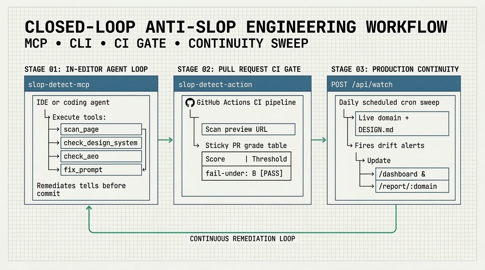

# slop-detect-mcp

> MCP server that lets AI coding agents scan landing pages for **AI-design-slop** and pull a ready-to-paste fix prompt — straight from the chat.

Part of [slop-detect](https://slop-detect.com): the versioned fingerprint that catches Cursor / v0 / Lovable template slop in the wild (live catalogue: [`/api/patterns`](https://slop-detect.com/api/patterns)). This package wraps the live `slop-detect.com` API as a [Model Context Protocol](https://modelcontextprotocol.io) server, so **Claude Code, Cursor, and Windsurf** can audit and de-slop pages without a browser or API key.

<p align="center">
  
</p>

## Tools

The same seven tools, with the same arguments, are served by this npm server and by the hosted endpoint `https://slop-detect.com/mcp`; the contract lives in [`packages/core/src/mcp-tools.ts`](../core/src/mcp-tools.ts). Results are short summaries (only the triggered patterns), with compact structured content.

| Tool | Input | What it does |
| --- | --- | --- |
| `scan_page` | `{ url, axes?, preset?, design_md_url?, detail? }` | Scans the page in headless Chromium and returns the score (0–100, **lower is better**), tier, grade and only the triggered patterns with evidence, plus a `scan_id` (npm server). `axes` adds `copy` and/or `craft`; `design_md_url` (`"auto"` or a URL) adds DESIGN.md compliance; `detail: "full"` returns the whole scan document. Results are never published. |
| `check_aeo` | `{ url }` | Checks whether search and AI answer engines can fetch, read and cite the page. Returns an AEO score 0–100 (**higher is better**), a tier (Eligible / Partially Eligible / Restricted) and the failed checks. The scanner does not impersonate vendor crawlers. |
| `check_design_system` | `{ url?, design_md_url?, scan_id? }` | Checks whether the page honors its own DESIGN.md (or DTCG tokens.json). Returns a compliance score 0–100 (**higher is better**), a tier (Aligned / Drifting / Off-system) and named drift. Default file is `<origin>/DESIGN.md`. |
| `fix_prompt` | `{ url?, scan_id?, patterns?, axes?, preset?, design_md_url?, brief? }` | Builds a copy-paste remediation prompt. Pass `scan_id` (npm server) or the triggered `patterns` to reuse a scan; `url` runs a new one. `brief: true` returns a 120-word avoid list (a generic one when no page is given). |
| `lint_design_md` | `{ design_md }` | Lints DESIGN.md text locally (broken refs, contrast below 4.5:1, orphaned tokens, specVersion). No page fetch and no score change. |
| `diff_design_md` | `{ base_design_md, head_design_md }` | Diffs two DESIGN.md documents. A removed or changed token is breaking. No page fetch. |
| `extract_design_system` | `{ url?, scan_id?, observed?, name?, format? }` | Extracts a starter Google Labs `DESIGN.md` and/or DTCG `2025.10` `tokens.json` from what a live page renders (or from `observed` tokens). `format`: `design_md` (default), `dtcg` or `both`. |

Misspelled or unknown arguments come back as an error naming the field. Older argument names (`content`, `base`/`head`, `designMd`, `copy: true`, `mode: "avoid"`) are still accepted.

> **Score polarity:** slop `0` = clean (Clean 0–9, Mild 10–27, Heavy 28+). AEO and design-system scores are inverted: **higher is better**.

Example asks: "scan https://example.com for slop", "can AI engines cite https://example.com?", "does https://example.com honor its DESIGN.md?", "give me a fix prompt for https://example.com".

## Install

No global install needed — clients run it on demand via `npx`:

```bash
npx -y slop-detect-mcp
```

Or install it explicitly:

```bash
npm install -g slop-detect-mcp
```

## Configure your client

All MCP clients use the same config shape. Add the server, restart the client, and ask it to "scan https://example.com for slop".

### Claude Code

Add to `.mcp.json` in your project root (or `claude_desktop_config.json` for Claude Desktop):

```json
{
  "mcpServers": {
    "slop-detect": {
      "command": "npx",
      "args": ["-y", "slop-detect-mcp"]
    }
  }
}
```

Or one-liner from the Claude Code CLI:

```bash
claude mcp add slop-detect -- npx -y slop-detect-mcp
```

### Cursor

Add to `.cursor/mcp.json` (project) or `~/.cursor/mcp.json` (global):

```json
{
  "mcpServers": {
    "slop-detect": {
      "command": "npx",
      "args": ["-y", "slop-detect-mcp"]
    }
  }
}
```

### Windsurf

Add to `~/.codeium/windsurf/mcp_config.json`:

```json
{
  "mcpServers": {
    "slop-detect": {
      "command": "npx",
      "args": ["-y", "slop-detect-mcp"]
    }
  }
}
```

## Configuration

| Env var | Default | Purpose |
| --- | --- | --- |
| `SLOP_DETECT_API` | `https://slop-detect.com` | API base URL. Point it at a local dev build (e.g. `http://localhost:8788`) when hacking on the web app. Ignored in `--local` mode. |
| `SLOP_DETECT_LOCAL` | unset | Set to `1` for the same behavior as `--local`. |

## Local mode

The hosted API rejects loopback addresses. Run the server in local mode to score `http://localhost`, `http://127.0.0.1`, and `file://` on this machine. `slop-detect` (the Playwright runner) is an optional peer, so name it in the same `npx` call:

```bash
npx -y -p slop-detect -p slop-detect-mcp slop-detect-mcp --local
```

A bare `npx -y slop-detect-mcp --local` does not install `slop-detect`, so every scan would fail. Local mode does not call `https://slop-detect.com/api/*`.

### Agent hooks

`slop-detect-hook` (this package's second bin, `hooks/scan-regression.mjs`) scans the dev server named by `SLOP_LOCAL_URL` or `.slop/local-url` after UI edits and before the agent stops, and reports only new findings. `npx slop-detect init` writes it for Claude Code, Cursor and Codex:

```bash
npx -y -p slop-detect -p slop-detect-mcp slop-detect-hook
```

As a hook it exits 2 with the message on stderr when the score rises or a new pattern appears (Claude sees it and fixes it before stopping). When the scan can't run (dev server down, wrong port) it exits 0 and does not block; on Stop it tells you in a `systemMessage`. It does nothing until a URL is set. See [`hooks/README.md`](hooks/README.md).

```json
{
  "mcpServers": {
    "slop-detect": {
      "command": "npx",
      "args": ["-y", "-p", "slop-detect", "-p", "slop-detect-mcp", "slop-detect-mcp", "--local"]
    }
  }
}
```

```json
{
  "mcpServers": {
    "slop-detect": {
      "command": "npx",
      "args": ["-y", "slop-detect-mcp"],
      "env": { "SLOP_DETECT_API": "http://localhost:8788" }
    }
  }
}
```

## Notes

- **No captcha, but rate-limited.** Non-browser callers skip the Turnstile challenge, so this server works headless, but the hosted API rate-limits scans per IP. A rate-limit error says how long to wait; local mode has no limit.
- **Agent scans are private.** Every hosted call sends `share: false`, so results get no public permalink and no per-domain history entry.
- **Errors come back as tool content**, never as crashes. A page that can't be scored (sign-in wall, empty client-rendered shell) is an error with the reason and a hint, never a Clean score. Unknown tools are JSON-RPC errors.

## License

MIT © Ravindra Kumar
